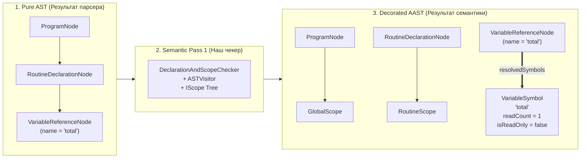
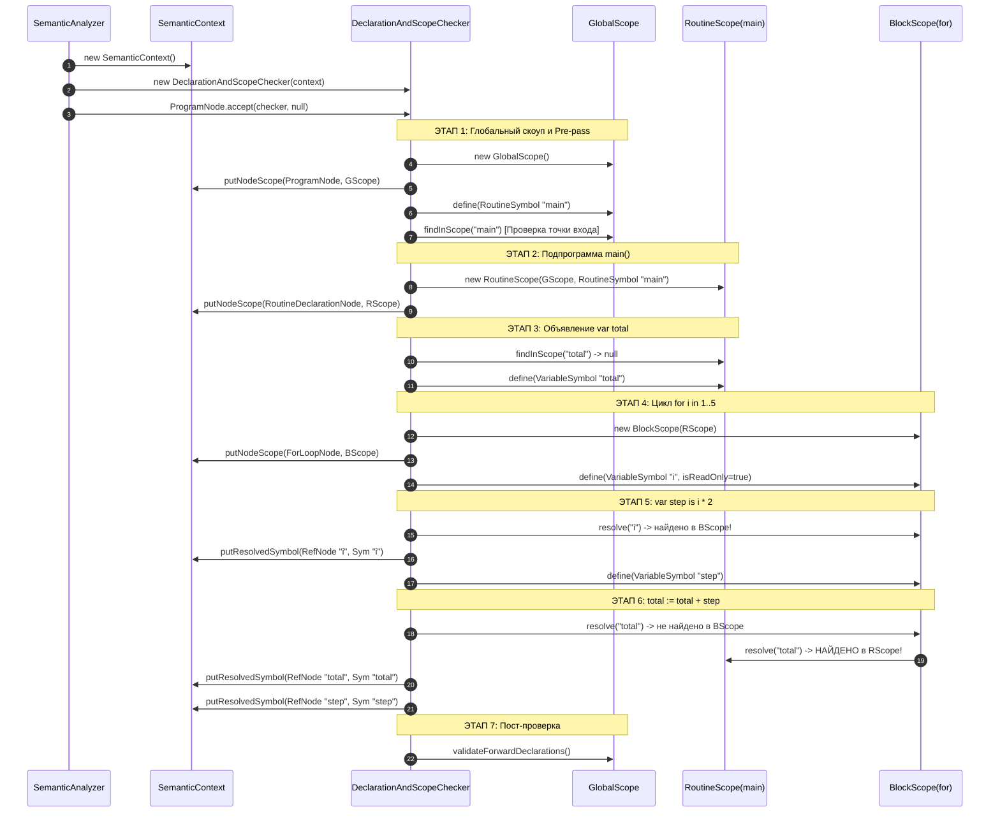
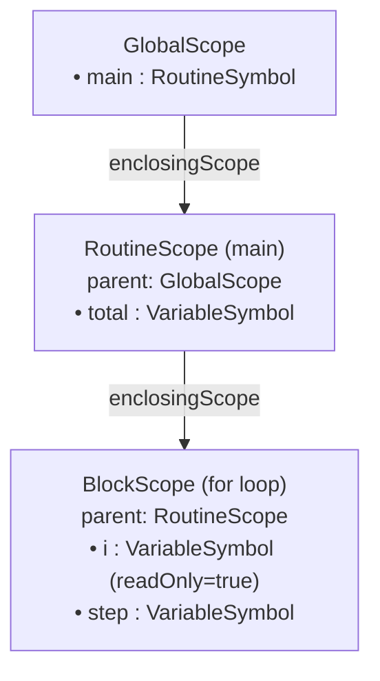

# Полный пошаговый пайплайн трансформации: от «Чистого» AST к декорированному AAST

**Проект**: Imperative JVM Compiler (Language I, расширение Vitebsk)  
**Компонент**: Семантический анализатор (Pass 1: Scope & Symbol Resolution)  
**Файл документа**: `materials/aast_transformation_pipeline.md`  
**Назначение**: Исчерпывающее пошаговое описание каждого действия компилятора при чтении синтаксического дерева и формировании семантической модели (AAST) с реальными примерами из кода.

---

## 1. Концепция: Pure AST против Decorated AAST



* **Pure AST («Чистое» дерево)**: Содержит исключительно синтаксическую структуру, построенную парсером. Узлы оперируют «сырыми» строковыми идентификаторами (например, `VariableReferenceNode("total")`). Дерево не знает, где объявлена эта переменная, существует ли она, каков её тип и контекст.
* **Annotated AST (AAST / Декорированное дерево)**: То же самое синтаксическое дерево, но **прошитое метаданными**:
  1. Каждый блок кода (`ProgramNode`, `RoutineDeclarationNode`, `ForLoopNode`, `IfStatementNode`) связан со своим объектом области видимости [`IScope`](file:///c:/Users/valer/Desktop/Imperative-JVM-Compiler/src/main/java/ru/innopolis/semantic/scope/IScope.java).
  2. Каждое обращение к переменной [`VariableReferenceNode`](file:///c:/Users/valer/Desktop/Imperative-JVM-Compiler/src/main/java/ru/innopolis/ast/expression/VariableReferenceNode.java) связано прямой ссылкой на семантический символ [`VariableSymbol`](file:///c:/Users/valer/Desktop/Imperative-JVM-Compiler/src/main/java/ru/innopolis/semantic/symbol/VariableSymbol.java).
  3. Каждый символ хранит метаданные времени компиляции (флаг неизменяемости `isReadOnly`, счётчик обращений `readCount`, объявленный тип).

---

## 2. Эталонный пример программы на Language I

Для детальной демонстрации каждого шага возьмём законченную программу с глубокой вложенностью областей видимости:

```pascal
routine main() is
    var total: integer is 0
    for i in 1..5 loop
        var step: integer is i * 2
        total := total + step
    end
end
```

### Структура дерева в памяти JVM после парсера:
Парсер создал граф объектов в куче (heap):
```text
ProgramNode
 └── declarations: [
      RoutineDeclarationNode (name: "main", returnType: null)
       └── body: BodyNode
            └── statements: [
                 VariableDeclarationNode (name: "total", type: PrimitiveTypeNode("integer"))
                  └── initializer: IntLiteralNode (value: 0),
                 
                 ForLoopNode (variable: "i")
                  ├── range: RangeNode (from: IntLiteralNode(1), to: IntLiteralNode(5))
                  └── body: BodyNode
                       └── statements: [
                            VariableDeclarationNode (name: "step", type: PrimitiveTypeNode("integer"))
                             └── initializer: BinaryExpressionNode (op: "*")
                                  ├── VariableReferenceNode (name: "i")
                                  └── IntLiteralNode (value: 2),
                            
                            AssignmentNode
                             ├── target: VariableReferenceNode (name: "total")
                             └── value: BinaryExpressionNode (op: "+")
                                  ├── VariableReferenceNode (name: "total")
                                  └── VariableReferenceNode (name: "step")
                       ]
            ]
 ]
```

---

## 3. Пошаговый трейс трансформации «На каждый чих»

Ниже подробно расписан каждый вызов метода, создание объектов и изменение состояния семантического контекста.



---

### Действие 1: Старт анализа и подготовка инфраструктуры

* **Кто вызывает**: Класс [`Main.java`](file:///c:/Users/valer/Desktop/Imperative-JVM-Compiler/src/main/java/ru/innopolis/Main.java) после завершения парсинга.
* **Реализация в коде**:
  ```java
  // ru.innopolis.semantic.SemanticAnalyzer
  public static AnalysisResult analyze(ProgramNode ast) {
      SemanticContext context = new SemanticContext();
      DeclarationAndScopeChecker checker = new DeclarationAndScopeChecker(context);
      ast.accept(checker, null);
      return new AnalysisResult(context.getErrors().isEmpty(), context.getErrors(), ast, context);
  }
  ```
* **Что происходит в памяти**:
  1. Выделяется память под [`SemanticContext`](file:///c:/Users/valer/Desktop/Imperative-JVM-Compiler/src/main/java/ru/innopolis/semantic/context/SemanticContext.java):
     * Создаётся пустой список `List<SemanticError> errors = new ArrayList<>()`.
     * Создаются пустые таблицы привязок `Map<ASTNode, IScope> nodeScopes = new HashMap<>()` и `Map<ASTNode, Symbol> resolvedSymbols = new HashMap<>()`.
  2. Создаётся чекер [`DeclarationAndScopeChecker`](file:///c:/Users/valer/Desktop/Imperative-JVM-Compiler/src/main/java/ru/innopolis/semantic/check/DeclarationAndScopeChecker.java), хранящий ссылку на этот `context`.

---

### Действие 2: Диспетчеризация корня — `ProgramNode.accept(checker, null)`

* **Кто вызывает**: Двойная диспетчеризация (Double Dispatch).
* **Реализация в коде**:
  ```java
  // ru.innopolis.ast.ProgramNode
  @Override
  public <R, C> R accept(ASTVisitor<R, C> visitor, C context) {
      return visitor.visit(this, context);
  }
  ```
* **Что происходит**: JVM определяет динамический тип узла (`ProgramNode`) и без каких-либо `instanceof` мгновенно направляет управление в перегруженный метод чекера `visit(ProgramNode node, IScope ignored)`.

---

### Действие 3: Создание глобальной области видимости `GlobalScope`

* **Где выполняется**: В начале метода `visit(ProgramNode node, IScope ignored)`.
* **Реализация в коде**:
  ```java
  GlobalScope globalScope = new GlobalScope();
  context.setGlobalScope(globalScope);
  context.putNodeScope(node, globalScope);
  ```
* **Что происходит в памяти**:
  1. Создаётся объект [`GlobalScope`](file:///c:/Users/valer/Desktop/Imperative-JVM-Compiler/src/main/java/ru/innopolis/semantic/scope/GlobalScope.java). У него поле `enclosingScope == null`, а внутренняя таблица `LinkedHashMap<String, Symbol> symbols` пока пуста.
  2. В `context.nodeScopes` добавляется запись:  
     `ProgramNode` $\longrightarrow$ `GlobalScope (id=@Global)`.

---

### Действие 4: Предварительный проход (Pre-pass) — сбор заголовков функций

* **Зачем нужно**: Чтобы функции могли вызываться до места их объявления в файле, компилятор обязан сначала зарегистрировать все имена типов и прототипы подпрограмм.
* **Реализация в коде**:
  ```java
  for (ASTNode decl : node.getDeclarations()) {
      if (decl instanceof RoutineDeclarationNode rDecl) {
          registerRoutineHeader(rDecl, globalScope);
      }
  }
  ```
* **Детальный шаг внутри `registerRoutineHeader`**:
  1. Чекер проверяет: `globalScope.findInScope("main")`. Возвращается `null` (имя свободно).
  2. Создаётся объект [`RoutineSymbol`](file:///c:/Users/valer/Desktop/Imperative-JVM-Compiler/src/main/java/ru/innopolis/semantic/symbol/RoutineSymbol.java):
     * `name = "main"`
     * `parameters = []`
     * `returnType = null`
     * `isForward = false` (так как у `main` есть тело `body != null`)
     * `isDefined = true`
  3. Регистрируем символ: `globalScope.define(mainSymbol)`.
  * **Состояние `GlobalScope.symbols`**:
    `{"main" -> RoutineSymbol(name="main", isDefined=true)}`.

---

### Действие 5: Валидация обязательной точки входа `main` (Vitebsk Check 2)

* **Реализация в коде**:
  ```java
  private void validateMainEntryPoint(GlobalScope globalScope, Span position) {
      Symbol mainSym = globalScope.findInScope("main");
      if (!(mainSym instanceof RoutineSymbol routine)) {
          context.addError(position, "Mandatory entry point 'routine main() is ... end' is missing");
          return;
      }
      if (!routine.getParameters().isEmpty()) {
          context.addError(position, "Entry point 'routine main' must not require parameters");
      }
  }
  ```
* **Результат проверки**: Символ `"main"` найден в `GlobalScope`, является `RoutineSymbol`, параметров 0 $\rightarrow$ ошибок нет!

---

### Действие 6: Основной проход — спуск в `RoutineDeclarationNode("main")`

* **Реализация в коде**:
  ```java
  decl.accept(this, globalScope);
  ```
* **Метод узла**:
  `routineDecl.accept(visitor, globalScope)` вызывает `visitor.visit(RoutineDeclarationNode, globalScope)`.

---

### Действие 7: Проверка ключевых слов и контекста функции (Curator Check 1)

* **Реализация в коде**:
  ```java
  // ru.innopolis.semantic.check.DeclarationAndScopeChecker
  @Override
  public Void visit(RoutineDeclarationNode node, IScope scope) {
      // 1. Проверка: функция объявлена на верхнем уровне?
      if (scope != context.getGlobalScope()) {
          context.addError(node.getPosition(), "Nested routines are not supported in Language I");
          return null;
      }
  ```
* **Результат проверки**: Переданный `scope` равен `globalScope`. Запрет вложенных функций соблюдён.

---

### Действие 8: Создание области видимости функции `RoutineScope`

* **Реализация в коде**:
  ```java
  RoutineSymbol rSym = (RoutineSymbol) scope.findInScope(node.getName());
  RoutineScope routineScope = new RoutineScope(scope, rSym);
  context.putNodeScope(node, routineScope);
  ```
* **Что происходит в памяти**:
  1. Создаётся объект [`RoutineScope`](file:///c:/Users/valer/Desktop/Imperative-JVM-Compiler/src/main/java/ru/innopolis/semantic/scope/RoutineScope.java):
     * Поле `enclosingScope` указывает на `GlobalScope`.
     * Поле `routine` указывает на `RoutineSymbol("main")`.
  2. В `context.nodeScopes` добавляется связь:  
     `RoutineDeclarationNode("main")` $\longrightarrow$ `RoutineScope (id=@Routine_main)`.
  3. Вызывается обход тела: `node.getBody().accept(this, routineScope)`.

---

### Действие 9: Вход в тело функции `visit(BodyNode)`

* **Реализация в коде**:
  ```java
  @Override
  public Void visit(BodyNode node, IScope scope) {
      for (ASTNode stmt : node.getStatements()) {
          stmt.accept(this, scope);
      }
      return null;
  }
  ```
* **Что происходит**: Чекер последовательно запускает обход операторов тела `main`, передавая им текущий контекст `routineScope`.

---

### Действие 10: Обработка `var total: integer is 0` (Curator Check 2)

Первым оператором является [`VariableDeclarationNode`](file:///c:/Users/valer/Desktop/Imperative-JVM-Compiler/src/main/java/ru/innopolis/ast/declaration/VariableDeclarationNode.java):
* **Реализация в коде**:
  ```java
  @Override
  public Void visit(VariableDeclarationNode node, IScope scope) {
      // ШАГ А: Сначала проверяем выражение инициализатора ДО регистрации переменной!
      if (node.getInitializer() != null) {
          node.getInitializer().accept(this, scope);
      }

      // ШАГ Б: Проверяем, нет ли дубликата в ТЕКУЩЕМ блоке
      if (scope.findInScope(node.getName()) != null) {
          context.addError(node.getPosition(), 
              "Variable '" + node.getName() + "' is already declared in this scope");
          return null;
      }

      // ШАГ В: Создаём символ и регистрируем в таблице
      VariableSymbol symbol = new VariableSymbol(
          node.getName(), node.getPosition(), node.getType(), false
      );
      scope.define(symbol);
      return null;
  }
  ```

#### Пошаговые микродействия для `total`:
1. **Обход инициализатора `IntLiteralNode(0)`**:
   * Вызывается `IntLiteralNode.accept(this, routineScope)`.
   * Литерал константен и не содержит ссылок на переменные. Возвращается `null`.
2. **Локальный поиск дубликата**:
   * `routineScope.findInScope("total")` возвращает `null` (в теле `main` переменной `total` ещё не было).
3. **Регистрация символа в `RoutineScope`**:
   * Создаётся объект [`VariableSymbol`](file:///c:/Users/valer/Desktop/Imperative-JVM-Compiler/src/main/java/ru/innopolis/semantic/symbol/VariableSymbol.java):
     * `name = "total"`
     * `isReadOnly = false`
     * `readCount = 0`
   * Вызывается `routineScope.define(symbol)`.
   * **Состояние `RoutineScope.symbols`**:
     `{"total" -> VariableSymbol(name="total", isReadOnly=false, readCount=0)}`.

---

### Действие 11: Обработка цикла `for i in 1..5 loop ... end` (Vitebsk Check 7)

Следующий узел в `BodyNode` — [`ForLoopNode`](file:///c:/Users/valer/Desktop/Imperative-JVM-Compiler/src/main/java/ru/innopolis/ast/statement/ForLoopNode.java):
* **Реализация в коде**:
  ```java
  @Override
  public Void visit(ForLoopNode node, IScope scope) {
      // 1. Проверяем выражения диапазона в текущем скоупе
      if (node.getRange() != null) {
          node.getRange().accept(this, scope);
      }

      // 2. Создаем изолированную область видимости для тела цикла
      BlockScope loopScope = new BlockScope(scope);
      context.putNodeScope(node, loopScope);

      // 3. Создаем переменную цикла со специальным флагом isReadOnly = true!
      VariableSymbol loopVar = new VariableSymbol(
          node.getVariable(), node.getPosition(), null, true
      );
      loopScope.define(loopVar);

      // 4. Обходим тело цикла во вложенном скоупе
      if (node.getBody() != null) {
          node.getBody().accept(this, loopScope);
      }
      return null;
  }
  ```

#### Пошаговые микродействия для цикла `for`:
1. **Обход диапазона**: `RangeNode(1..5)` посещается в контексте `routineScope`. Литералы `1` и `5` валидны.
2. **Создание области видимости цикла**:
   * Создаётся объект [`BlockScope`](file:///c:/Users/valer/Desktop/Imperative-JVM-Compiler/src/main/java/ru/innopolis/semantic/scope/BlockScope.java).
   * Поле `enclosingScope` указывает на `routineScope`.
   * В `context.nodeScopes` добавляется запись:  
     `ForLoopNode` $\longrightarrow$ `BlockScope (id=@LoopScope_1)`.
3. **Регистрация счетчика цикла с защитой от перезаписи**:
   * Создаётся `VariableSymbol("i")`:
     * `name = "i"`
     * **`isReadOnly = true`**
     * `readCount = 0`
   * Регистрируется: `loopScope.define(iVar)`.
   * **Состояние `BlockScope.symbols`**:
     `{"i" -> VariableSymbol(name="i", isReadOnly=true, readCount=0)}`.
4. **Спуск во вложенное тело**:
   * Вызывается `forBody.accept(this, loopScope)`.

---

### Действие 12: Объявление внутри цикла `var step: integer is i * 2`

Чекер входит в тело цикла и встречает объявление локальной переменной `step`:

1. **Проверка инициализатора `i * 2`**:
   * Вызывается `node.getInitializer().accept(this, loopScope)`.
   * Это узел [`BinaryExpressionNode`](file:///c:/Users/valer/Desktop/Imperative-JVM-Compiler/src/main/java/ru/innopolis/ast/expression/BinaryExpressionNode.java).
   * Базовый визитор обходит его левую и правую части:
     * `left.accept(this, loopScope)` $\longrightarrow$ попадает в узел [`VariableReferenceNode("i")`](file:///c:/Users/valer/Desktop/Imperative-JVM-Compiler/src/main/java/ru/innopolis/ast/expression/VariableReferenceNode.java).

---

### Действие 13: Декорирование ссылки на переменную `VariableReferenceNode("i")`

Это ключевой момент превращения AST в AAST:
* **Реализация в коде**:
  ```java
  // ru.innopolis.semantic.check.DeclarationAndScopeChecker
  @Override
  public Void visit(VariableReferenceNode node, IScope scope) {
      Symbol sym = scope.resolve(node.getName());
      if (sym == null) {
          context.addError(node.getPosition(), "Undeclared identifier '" + node.getName() + "'");
          return null;
      }
      if (sym instanceof VariableSymbol varSym) {
          varSym.incrementReadCount();
      }
      context.putResolvedSymbol(node, sym);
      return null;
  }
  ```

#### Как сработал лексический резолвинг `scope.resolve("i")`:
1. Метод `loopScope.findInScope("i")` ищет переменную локально в таблице цикла.
2. Символ `VariableSymbol("i")` найден прямо в `loopScope`!
3. Вызывается `varSym.incrementReadCount()`: счётчик `i` стал равен `1`.
4. **Запись AAST-декорации**:  
   В мапу `context.resolvedSymbols` добавляется прямая ссылка:  
   `VariableReferenceNode("i")` $\Longrightarrow$ `VariableSymbol("i", readCount=1, isReadOnly=true)`.

Затем обходится правая часть выражения `IntLiteralNode(2)`.

2. **Регистрация переменной `step`**:
   * `loopScope.findInScope("step")` $\longrightarrow$ `null`.
   * Создаётся `VariableSymbol("step")` с `isReadOnly = false, readCount = 0`.
   * `loopScope.define(stepSymbol)`.
   * **Состояние `BlockScope.symbols`**:
     ```text
     "i"    -> VariableSymbol(name="i", isReadOnly=true, readCount=1)
     "step" -> VariableSymbol(name="step", isReadOnly=false, readCount=0)
     ```

---

### Действие 14: Присваивание `total := total + step`

Второй оператор внутри цикла — [`AssignmentNode`](file:///c:/Users/valer/Desktop/Imperative-JVM-Compiler/src/main/java/ru/innopolis/ast/statement/AssignmentNode.java):
* **Реализация в коде**:
  ```java
  @Override
  public Void visit(AssignmentNode node, IScope scope) {
      // 1. Проверяем цель присваивания
      if (node.getTarget() instanceof VariableReferenceNode varRef) {
          Symbol sym = scope.resolve(varRef.getName());
          if (sym == null) {
              context.addError(varRef.getPosition(), "Undeclared identifier '" + varRef.getName() + "'");
          } else if (sym instanceof VariableSymbol varSym && varSym.isReadOnly()) {
              context.addError(node.getPosition(), 
                  "Cannot assign to read-only loop variable '" + varSym.getName() + "'");
          } else {
              context.putResolvedSymbol(varRef, sym);
          }
      }

      // 2. Проверяем вычисляемое выражение правой части
      if (node.getValue() != null) {
          node.getValue().accept(this, scope);
      }
      return null;
  }
  ```

#### Шаг А: Проверка левой части (Target: `total`):
1. Вызывается восходящий лексический поиск: `loopScope.resolve("total")`.
   * Шаг 1: `loopScope.findInScope("total")` $\longrightarrow$ `null` (в теле цикла переменной `total` нет!).
   * Шаг 2: `loopScope.getEnclosingScope()` возвращает `routineScope`.
   * Шаг 3: `routineScope.findInScope("total")` $\longrightarrow$ **НАЙДЕН!** Возвращён объект `VariableSymbol("total")`.
2. Проверка флага константности: `totalSym.isReadOnly()` равен `false`. Модификация разрешена!
3. **AAST-декорация цели**:  
   `context.putResolvedSymbol(targetNode("total"), totalSymbol)`.

#### Шаг Б: Проверка правой части (Value: `total + step`):
1. Обход `BinaryExpressionNode(+)`.
2. Левый операнд `VariableReferenceNode("total")`:
   * `loopScope.resolve("total")` поднимается до `routineScope` и находит `totalSymbol`.
   * `totalSymbol.incrementReadCount()` $\longrightarrow$ счётчик обращений `total` стал равен `1`.
   * Декорация: `context.putResolvedSymbol(readRef("total"), totalSymbol)`.
3. Правый операнд `VariableReferenceNode("step")`:
   * `loopScope.resolve("step")` находит `stepSymbol` в текущем `loopScope`.
   * `stepSymbol.incrementReadCount()` $\longrightarrow$ счётчик обращений `step` стал равен `1`.
   * Декорация: `context.putResolvedSymbol(readRef("step"), stepSymbol)`.

---

### Действие 15: Всплытие по стеку и завершение областей видимости

1. **Завершение цикла `for`**:
   * Чекер завершает `visit(BodyNode)` цикла и выходит из `visit(ForLoopNode)`.
   * Область видимости `loopScope` завершает свою активность. Переменные `i` и `step` больше не доступны для операторов, находящихся ниже цикла.
2. **Завершение подпрограммы `main`**:
   * Чекер завершает `visit(BodyNode)` подпрограммы и выходит из `visit(RoutineDeclarationNode)`.
   * Область видимости `routineScope` завершает свою активность.
3. **Финализация в `visit(ProgramNode)`**:
   * Вызывается вспомогательный метод `validateForwardDeclarations(globalScope)`:
     * Проверяются все подпрограммы в `GlobalScope`.
     * У `main` флаг `isForward == false`, реализация на месте.
4. **Возврат результата**:
   * `context.getErrors()` пуст (`errors.size() == 0`).
   * Создаётся и возвращается объект [`AnalysisResult(isSuccess=true, ...)`](file:///c:/Users/valer/Desktop/Imperative-JVM-Compiler/src/main/java/ru/innopolis/semantic/AnalysisResult.java).

---

## 4. Итоговая семантическая карта памяти (Annotated AST)

После выполнения первого прохода структуры в оперативной памяти выглядят следующим образом:

### 1. Дерево областей видимости (Scope Tree)



### 2. Таблица символов (Symbol Table Dump)

| Символ | Тип сущности | Область видимости | `isReadOnly` | `readCount` | Назначение |
| :--- | :--- | :--- | :---: | :---: | :--- |
| `main` | `RoutineSymbol` | `GlobalScope` | — | — | Обязательная точка входа |
| `total` | `VariableSymbol` | `RoutineScope(main)` | `false` | **1** | Аккумулятор суммы |
| `i` | `VariableSymbol` | `BlockScope(for)` | **`true`** | **1** | Счетчик цикла, защищён от записи |
| `step` | `VariableSymbol` | `BlockScope(for)` | `false` | **1** | Промежуточное значение шага |

### 3. Таблица AAST-декораций (`SemanticContext.resolvedSymbols`)

Каждый конкретный узел синтаксического дерева получил прямую ссылку на семантический символ в памяти:

```text
[AST Узел]                                         ---> [Связанный семантический объект]
---------------------------------------------------------------------------------------------------------
VariableReferenceNode("total") [Assignment Target] ---> VariableSymbol("total", Scope=RoutineScope)
VariableReferenceNode("i")     [in i * 2]          ---> VariableSymbol("i", Scope=BlockScope, isReadOnly=true)
VariableReferenceNode("total") [in total + step]   ---> VariableSymbol("total", Scope=RoutineScope)
VariableReferenceNode("step")  [in total + step]   ---> VariableSymbol("step", Scope=BlockScope)
```

---

## 5. Практическая выгода для Человека 2 и Человека 3

Благодаря созданной AAST-инфраструктуре напарникам не нужно заново разбирать имена:

### Для Человека 2 (TypeChecker):
Когда тайпчекер проверяет выражение `total + step`:
```java
@Override
public Type visit(VariableReferenceNode node, IScope scope) {
    // Не нужно ничего искать в строках! Ссылка уже есть в контексте:
    Symbol sym = context.getResolvedSymbol(node);
    return typeSystem.resolveType(sym.getTypeNode()); // Мгновенный ответ: PrimitiveType.INTEGER
}
```

### Для Человека 3 (Optimizers):
Когда оптимизатор ищет неиспользуемые переменные (Dead Code Elimination):
```java
@Override
public ASTNode visit(VariableDeclarationNode node, Void ctx) {
    VariableSymbol sym = (VariableSymbol) currentScope.findInScope(node.getName());
    if (sym.getReadCount() == 0) {
        // Переменная ни разу не читалась! Удаляем узел из AST:
        return null;
    }
    return node;
}
```

---
*Документ подготовлен для команды проекта компилятора Vitebsk.*

