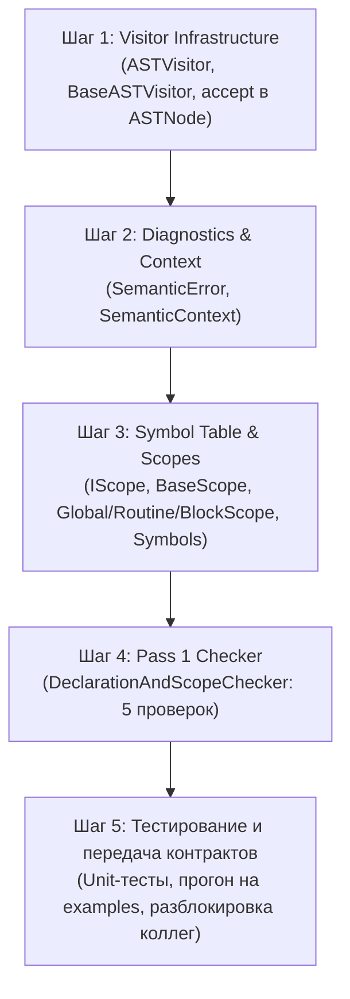

# План реализации: Человек 1 (Фундамент компилятора, Области видимости и Структурные проверки)

Настоящий документ представляет собой пошаговое руководство по разработке модуля первого участника команды Vitebsk в строгом соответствии с генеральным планом [`materials/semantic_analyzer_plan.md`](file:///c:/Users/valer/Desktop/Imperative-JVM-Compiler/materials/semantic_analyzer_plan.md).

---

## 1. Сверка зоны ответственности с генеральным планом

В ваши обязанности входят:
1. **Архитектурный фундамент (Foundational Core)**:
   - Шаблон `Visitor` для обхода синтаксического дерева ([`ASTVisitor<R, C>`](file:///c:/Users/valer/Desktop/Imperative-JVM-Compiler/src/main/java/ru/innopolis/ast/ASTNode.java)).
   - Модификация узлов AST методом `accept()`.
   - Система диагностики и контекста (`SemanticContext`, `SemanticError`).
2. **Иерархия областей видимости и Таблица символов**:
   - Интерфейс `IScope` и классы `BaseScope`, `GlobalScope`, `RoutineScope`, `BlockScope`.
   - Модель символов `Symbol`, `VariableSymbol`, `RoutineSymbol`, `TypeSymbol`, `ParameterSymbol`.
3. **Первый проход компилятора (`DeclarationAndScopeChecker`) и 5 семантических проверок**:
   - **Curator Check 1**: `Correct Keyword Usage` (`return` только внутри подпрограмм, запрет вложенных процедур).
   - **Curator Check 2**: `Declarations Before Usage & Shadowing` (объявление до использования, уникальность в блоке, сокрытие).
   - **Vitebsk Check 2**: `Explicit Entry Point` (обязательное наличие глобальной `routine main()`).
   - **Vitebsk Check 7**: `Read-Only for Loop Variable` (запрет мутации счетчика цикла `for`).
   - **Vitebsk Check 8**: `Forward Routine Declarations Matching` (закрытие всех forward-деклараций полной реализацией).

---

## 2. Пошаговый план разработки



---

### Шаг 1: Инфраструктура обхода дерева (Visitor Pattern)
**Цель**: Дать возможность всем троим разработчикам безопасно обходить и анализировать AST без нарушения инкапсуляции.

1. **Создать интерфейс `ASTVisitor<R, C>`** в пакете `ru.innopolis.semantic.visitor`:
   - Обобщённые параметры:
     - `R` — тип возвращаемого значения (например, `Void` для скоупов, `Type` для тайпчекера).
     - `C` — контекст обхода (например, текущий `IScope`).
   - Методы `visit(...)` для всех 28 конкретных узлов AST:
     - Программа: `ProgramNode`.
     - Декларации: `RoutineDeclarationNode`, `VariableDeclarationNode`, `TypeDeclarationNode`, `ParameterNode`.
     - Операторы: `BodyNode`, `AssignmentNode`, `IfStatementNode`, `WhileLoopNode`, `ForLoopNode`, `RangeNode`, `PrintStatementNode`, `ReturnStatementNode`, `RoutineCallStatementNode`.
     - Выражения: `BinaryExpressionNode`, `UnaryExpressionNode`, `CastExpressionNode`, `ArrayAccessNode`, `RecordAccessNode`, `RoutineCallExpressionNode`, `VariableReferenceNode`.
     - Литералы: `IntLiteralNode`, `RealLiteralNode`, `BoolLiteralNode`, `StringLiteralNode`.
     - Типы: `PrimitiveTypeNode`, `ArrayTypeNode`, `RecordTypeNode`, `NamedTypeNode`.
2. **Создать вспомогательный класс `BaseASTVisitor<R, C>`**:
   - Реализует `ASTVisitor<R, C>`.
   - Для всех методов по умолчанию предоставляет рекурсивный спуск по дочерним узлам (child nodes), чтобы в конкретных чекерах можно было переопределять только нужные методы `visit`.
3. **Модифицировать базовый класс [`ASTNode.java`](file:///c:/Users/valer/Desktop/Imperative-JVM-Compiler/src/main/java/ru/innopolis/ast/ASTNode.java)**:
   - Добавить абстрактный метод:
     ```java
     public abstract <R, C> R accept(ASTVisitor<R, C> visitor, C context);
     ```
4. **Реализовать `accept` во всех конкретных узлах AST**:
   - Шаблонная реализация в каждом классе:
     ```java
     @Override
     public <R, C> R accept(ASTVisitor<R, C> visitor, C context) {
         return visitor.visit(this, context);
     }
     ```

---

### Шаг 2: Диагностика и Контекст анализа (`SemanticContext`)
**Цель**: Создать единый реестр семантических ошибок и хранилище связей Annotated AST (AAST).

1. **Создать класс `SemanticError`** в пакете `ru.innopolis.semantic.context`:
   - Поля:
     - `Span position` (координаты: строка, начальная и конечная колонки).
     - `String message` (понятное человеку сообщение об ошибке).
   - Метод `toString()` в формате: `Error at [line:col-line:col]: message`.
2. **Создать класс `SemanticContext`** в пакете `ru.innopolis.semantic.context`:
   - Хранилище ошибок:
     ```java
     private final List<SemanticError> errors = new ArrayList<>();
     public void addError(Span position, String message);
     public boolean hasErrors();
     public List<SemanticError> getErrors();
     ```
   - Связывание узлов дерева со структурами семантики (AAST-декорирование):
     ```java
     private final Map<ASTNode, IScope> nodeScopes = new HashMap<>();
     private final Map<VariableReferenceNode, Symbol> resolvedSymbols = new HashMap<>();
     private final Map<RoutineCallExpressionNode, RoutineSymbol> resolvedRoutines = new HashMap<>();
     private GlobalScope globalScope;
     ```

---

### Шаг 3: Модель символов и Областей видимости (Scope & Symbol Hierarchy)
**Цель**: Реализовать табличную модель видимости идентификаторов согласно лекции 4 (слайды 10–11).

1. **Создать базовые классы символов в `ru.innopolis.semantic.symbol`**:
   - `Symbol` (абстрактный):
     - `String name`, `Span position`.
   - `VariableSymbol extends Symbol`:
     - `boolean isReadOnly` (флаг для переменных цикла `for`).
     - `int readCount` (счётчик чтений для последующей оптимизации Человека 3).
     - `TypeNode syntacticType` (синтаксический узел типа, пока Человек 2 пишет семантические типы).
   - `RoutineSymbol extends Symbol`:
     - `List<ParameterSymbol> parameters`.
     - `TypeNode returnTypeNode` (может быть `null` для void).
     - `boolean isForward` (флаг опережающего объявления).
     - `boolean isDefined` (флаг наличия полного тела).
   - `TypeSymbol extends Symbol`:
     - `TypeNode declaredType`.
   - `ParameterSymbol extends Symbol`:
     - `TypeNode typeNode`.
2. **Создать иерархию областей видимости в `ru.innopolis.semantic.scope`**:
   - **Интерфейс `IScope`**:
     ```java
     public interface IScope {
         IScope getEnclosingScope();
         void define(Symbol symbol);
         Symbol findInScope(String name);   // Поиск строго в текущей таблице (для проверки дубликатов)
         Symbol resolve(String name);       // Рекурсивный поиск вверх по дереву скоупов
     }
     ```
   - **Класс `BaseScope implements IScope`**:
     - Поле `protected final IScope enclosingScope;`
     - Поле `protected final Map<String, Symbol> symbols = new LinkedHashMap<>();`
     - Реализация `findInScope(name)`: `return symbols.get(name);`
     - Реализация `resolve(name)`:
       ```java
       Symbol s = findInScope(name);
       if (s != null) return s;
       if (enclosingScope != null) return enclosingScope.resolve(name);
       return null;
       ```
   - **Класс `GlobalScope extends BaseScope`**:
     - `enclosingScope == null`.
     - Хранит глобальные подпрограммы и пользовательские типы.
   - **Класс `RoutineScope extends BaseScope`**:
     - Хранит ссылку на родительский `RoutineSymbol`.
     - Содержит формальные параметры и локальные переменные рутины.
   - **Класс `BlockScope extends BaseScope`**:
     - Создаётся для каждого составного оператора (`if`, `while`, `for`, локальный `BodyNode`).

---

### Шаг 4: Реализация первого прохода (`DeclarationAndScopeChecker`)
**Цель**: Построить дерево скоупов, разрешить все имена и выполнить ваши 5 семантических проверок.

Создать класс `DeclarationAndScopeChecker extends BaseASTVisitor<Void, IScope>` в пакете `ru.innopolis.semantic.check`:

#### 1. Обработка программы (`ProgramNode`)
- **Этап 4.1: Предварительная регистрация типов и рутин (Pre-pass)**:
  - Обойти верхнеуровневые декларации программы:
    - Для `TypeDeclarationNode`:
      - Проверить `scope.findInScope(name)`. Если уже есть $\rightarrow$ ошибка `Duplicate type declaration: X` (**Curator Check 2**).
      - Зарегистрировать `TypeSymbol`.
    - Для `RoutineDeclarationNode`:
      - Если рутина с таким именем уже есть в `GlobalScope`:
        - Если предыдущая была `isForward = true`, а текущая с телом:
          - Проверить идентичность количества параметров и возвращаемого типа (**Vitebsk Check 8**).
          - Если сигнатуры совпадают: пометить рутину как `isDefined = true`, `isForward = false`.
          - Если сигнатуры отличаются: выдать ошибку `Signature mismatch for forward declaration: X`.
        - Иначе: выдать ошибку `Duplicate routine declaration: X` (**Curator Check 2**).
      - Иначе: создать `RoutineSymbol(isForward = r.isForwardDeclaration(), isDefined = !r.isForwardDeclaration())` и сохранить в глобальный скоуп.
- **Этап 4.2: Проверка точки входа (Vitebsk Check 2)**:
  - Вызвать `globalScope.findInScope("main")`.
  - Если символ отсутствует или не является `RoutineSymbol` $\rightarrow$ выдать ошибку `Mandatory entry point 'routine main() is ... end' is missing`.
  - Если у `main` количество параметров $> 0$ $\rightarrow$ выдать ошибку `Entry point 'main' must not require parameters`.
- **Этап 4.3: Обход содержимого рутин**:
  - Запустить рекурсивный визит всех объявлений в контексте `GlobalScope`.
- **Этап 4.4: Завершающая валидация forward-объявлений (Vitebsk Check 8)**:
  - Пройти по всем `RoutineSymbol` в `GlobalScope`: если остался хотя бы один с `isForward == true`, выдать ошибку `Forward routine 'X' declared at line Y has no implementation`.

#### 2. Обработка подпрограммы (`RoutineDeclarationNode`)
- Проверить, что текущий скоуп — именно `GlobalScope`. Если скоуп не глобальный $\rightarrow$ выдать ошибку `Nested routines are not supported in Language I` (**Curator Check 1**).
- Создать новый `RoutineScope(globalScope, routineSymbol)`.
- Сохранить скоуп в `context.putNodeScope(node, routineScope)`.
- Добавить параметры в `routineScope`:
  - Для каждого `ParameterNode`: проверить `findInScope(name)`. При дубликате $\rightarrow$ ошибка `Duplicate parameter name: X`. Добавить `ParameterSymbol`.
- Обойти тело процедуры (`BodyNode` или `expressionBody`) в контексте `routineScope`.

#### 3. Обработка локальных переменных (`VariableDeclarationNode`)
- Проверить `currentScope.findInScope(name)`.
- Если переменная уже объявлена в **текущем блоке** $\rightarrow$ ошибка `Variable 'X' is already declared in this scope` (**Curator Check 2**).
- Зарегистрировать `VariableSymbol` в `currentScope`.
- Если есть `initializer`, обойти его дочерние узлы в текущем скоупе.

#### 4. Обработка ссылок на переменные (`VariableReferenceNode`)
- Вызвать `Symbol sym = currentScope.resolve(node.getName())`.
- Если `sym == null` $\rightarrow$ выдать ошибку `Undeclared variable 'X' referenced at line Y` (**Curator Check 2**).
- Иначе: увеличить `readCount` у `VariableSymbol` и привязать узел: `context.putResolvedSymbol(node, sym)`.

#### 5. Обработка оператора присваивания (`AssignmentNode`)
- Проверить левую часть `node.getTarget()`:
  - Если левая часть — `VariableReferenceNode`:
    - Найти символ: `Symbol sym = currentScope.resolve(target.getName())`.
    - Если `sym instanceof VariableSymbol varSym && varSym.isReadOnly()`:
      - Выдать ошибку `Cannot assign to read-only loop variable 'X'` (**Vitebsk Check 7**).
- Обойти выражения левой и правой части.

#### 6. Обработка цикла со счетчиком (`ForLoopNode`)
- Создать дочерний `BlockScope(currentScope)`.
- Зарегистрировать переменную цикла `node.getVariableName()` в новом скоупе как `VariableSymbol(isReadOnly = true)` (**Vitebsk Check 7**).
- Обойти `range` и тело цикла `body` в созданном `BlockScope`.

#### 7. Обработка оператора возврата (`ReturnStatementNode`)
- Проверить цепочку скоупов: есть ли среди предков `currentScope` хотя бы один `RoutineScope`.
- Если `findEnclosingRoutineScope(currentScope) == null` $\rightarrow$ выдать ошибку `Return statement is not allowed outside routine body` (**Curator Check 1**).

---

### Шаг 5: Тестирование и верификация

1. **Позитивные тесты**:
   - Прогнать все существующие примеры из папки `examples/` (`1.txt` — `15.txt`).
   - Убедиться, что `DeclarationAndScopeChecker` корректно строит дерево скоупов, видит `main()`, корректно закрывает forward-декларации и не генерирует ложных ошибок.
2. **Негативные тесты (тестирование семантических ошибок)**:
   - `testUndeclaredVariable()`: обращение к `foo` до объявления $\rightarrow$ ловит ошибку.
   - `testDuplicateDeclarationInSameBlock()`: два `var a` в одном блоке $\rightarrow$ ловит ошибку.
   - `testMissingMain()`: программа без `routine main()` $\rightarrow$ ловит ошибку `Entry point missing`.
   - `testReturnOutsideFunction()`: оператор `return` на верхнем уровне файла $\rightarrow$ ловит ошибку.
   - `testAssignToForLoopVariable()`: код `for i in 1..10 loop i := 5; end` $\rightarrow$ ловит ошибку `Cannot assign to read-only loop variable`.
   - `testUnmatchedForwardDeclaration()`: `routine bar(): int;` без последующего тела $\rightarrow$ ловит ошибку.
3. **Передача контрактов напарникам**:
   - Сообщить **Человеку 2**: интерфейс `IScope` готов, метод `accept()` внедрён. Человек 2 может начинать `TypeChecker`, используя `scope.resolve()`.
   - Сообщить **Человеку 3**: узлы готовы к обходу, поле `readCount` в `VariableSymbol` наполняется. Человек 3 может начинать реализацию оптимизаторов.

---

## 3. Чек-лист готовности вашей части к защите

- [ ] Интерфейс `ASTVisitor` содержит методы для всех типов узлов.
- [ ] Метод `accept()` реализован во всех классах наследниках `ASTNode`.
- [ ] Иерархия `IScope` (`BaseScope`, `GlobalScope`, `RoutineScope`, `BlockScope`) корректно отрабатывает сокрытие (shadowing).
- [ ] Ошибка при обращении к необъявленной переменной или функции (**Curator Check 2**).
- [ ] Ошибка при дубликате имени в пределах одного скоупа (**Curator Check 2**).
- [ ] Ошибка при `return` вне подпрограммы (**Curator Check 1**).
- [ ] Ошибка при отсутствии процедуры `main` (**Vitebsk Check 2**).
- [ ] Ошибка при изменении переменной цикла `for` (**Vitebsk Check 7**).
- [ ] Ошибка при незакрытом forward-объявлении (**Vitebsk Check 8**).
- [ ] Все 15 файлов из `examples/` успешно проходят анализ первого прохода.
