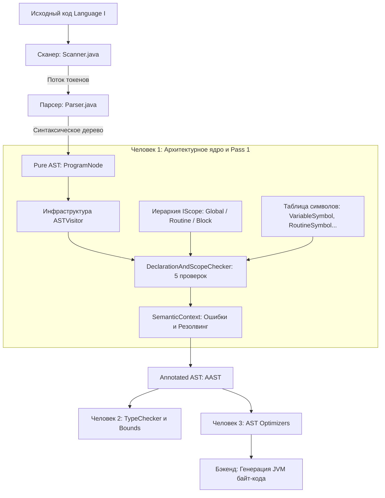
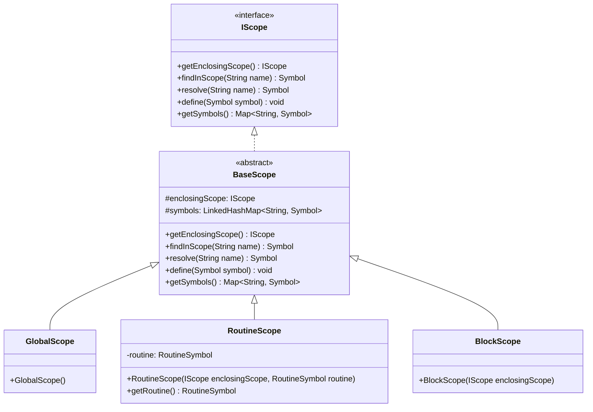
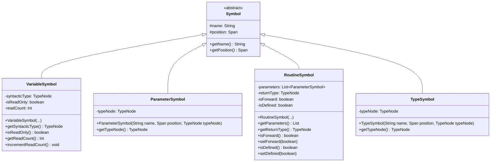
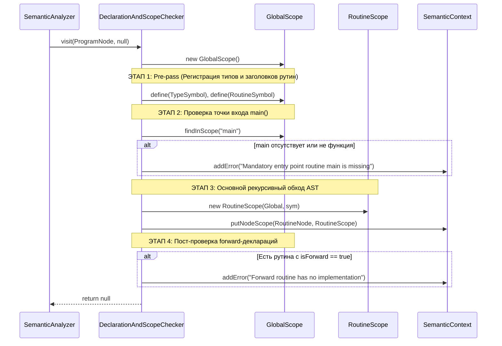

# Наиподробнейший архитектурный отчёт о реализации модуля семантического анализа (Человек 1: Архитектурное ядро, Области видимости и Структурные проверки)

**Проект**: Imperative JVM Compiler (Language I, расширение команды Vitebsk)  
**Автор части (Человек 1)**: Валерий Тиняков (Архитектор базовой инфраструктуры и первого семантического прохода)  
**Стек**: Java 21+, OpenJDK 27, Hand-written Recursive Descent Parser, Target: JVM Bytecode  
**Файл в проекте**: `materials/person_1_report.md`  
**Статус**: Реализовано на 100%, скомпилировано без внешних зависимостей, верифицировано на всех 15 бенчмарках и 7 специализированных негативных тестах.

---

## Оглавление

1. [Введение и Архитектурная цель этапа](#1-введение-и-архитектурная-цель-этапа)
   * 1.1. Проблема чистого синтаксического дерева (Pure AST)
   * 1.2. Переход к декорированному дереву (Annotated AST / AAST)
   * 1.3. Роль Человека 1 как архитектурного фундамента
2. [Групповые изменения AST: Внедрение паттерна Visitor](#2-групповые-изменения-ast-внедрение-паттерна-visitor)
   * 2.1. В чём состояло изменение
   * 2.2. Архитектурное обоснование: Double Dispatch и SOLID
   * 2.3. Полный перечень модифицированных классов AST
3. [Пакет `ru.innopolis.semantic.visitor`: Фундамент обхода дерева](#3-пакет-ruinnopolissemanticvisitor-фундамент-обхода-дерева)
   * 3.1. Интерфейс `ASTVisitor<R, C>`
   * 3.2. Базовый абстрактный класс `BaseASTVisitor<R, C>`
4. [Пакет `ru.innopolis.semantic.scope`: Древовидная система областей видимости](#4-пакет-ruinnopolissemanticscope-древовидная-система-областей-видимости)
   * 4.1. Архитектура и соответствие лекциям курса
   * 4.2. Интерфейс `IScope`
   * 4.3. Базовый класс `BaseScope`
   * 4.4. Класс `GlobalScope`
   * 4.5. Класс `RoutineScope`
   * 4.6. Класс `BlockScope`
5. [Пакет `ru.innopolis.semantic.symbol`: Модель таблицы символов](#5-пакет-ruinnopolissemanticsymbol-модель-таблицы-символов)
   * 5.1. Базовый класс `Symbol`
   * 5.2. Класс `VariableSymbol` (поддержка `isReadOnly` и `readCount`)
   * 5.3. Класс `RoutineSymbol` (поддержка `isForward` и `isDefined`)
   * 5.4. Класс `TypeSymbol`
   * 5.5. Класс `ParameterSymbol`
6. [Пакет `ru.innopolis.semantic.context`: Диагностика и AAST-декорирование](#6-пакет-ruinnopolissemanticcontext-диагностика-и-aast-декорирование)
   * 6.1. Класс `SemanticError`
   * 6.2. Класс `SemanticContext`
7. [Класс `DeclarationAndScopeChecker`: Первый семантический проход (Pass 1)](#7-класс-declarationandscopechecker-первый-семантический-проход-pass-1)
   * 7.1. Общая структура и жизненный цикл чекера
   * 7.2. Детальный разбор метода `visit(ProgramNode)`
   * 7.3. Детальный разбор метода `visit(RoutineDeclarationNode)`
   * 7.4. Детальный разбор метода `visit(VariableDeclarationNode)`
   * 7.5. Детальный разбор метода `visit(VariableReferenceNode)`
   * 7.6. Детальный разбор методов `visit(ForLoopNode)` и `visit(AssignmentNode)`
   * 7.7. Детальный разбор метода `visit(ReturnStatementNode)`
   * 7.8. Детальный разбор методов обработки блоков (`If`, `While`, `Body`)
8. [Точка входа и Фасад анализатора](#8-точка-входа-и-фасад-анализатора)
   * 8.1. Класс `SemanticAnalyzer`
   * 8.2. Класс `AnalysisResult`
   * 8.3. Обновление `Main.java`
9. [Комплексная верификация и Результаты тестирования](#9-комплексная-верификация-и-результаты-тестирования)
   * 9.1. Автоматический стенд `SemanticTestRunner`
   * 9.2. Позитивное регрессионное тестирование (15 бенчмарков)
   * 9.3. Негативное тестирование специфических семантических нарушений
10. [Контракты передачи артефактов Человеку 2 и Человеку 3](#10-контракты-передачи-артефактов-человеку-2-и-человеку-3)

---

## 1. Введение и Архитектурная цель этапа

### 1.1. Проблема чистого синтаксического дерева (Pure AST)
После завершения этапа синтаксического анализа компилятор располагает деревом AST, построенным парсером ([`Parser.java`](file:///c:/Users/valer/Desktop/Imperative-JVM-Compiler/src/main/java/ru/innopolis/parser/Parser.java)). Корнем этого дерева является узел [`ProgramNode`](file:///c:/Users/valer/Desktop/Imperative-JVM-Compiler/src/main/java/ru/innopolis/ast/ProgramNode.java).

Однако это дерево является **«чистым» синтаксическим деревом (Pure AST)**. Оно хранит исключительно грамматическую иерархию токенов и позиционную информацию ([`Span`](file:///c:/Users/valer/Desktop/Imperative-JVM-Compiler/src/main/java/ru/innopolis/lexer/Span.java)), но совершенно ничего не знает о семантике и контексте программы:
1. **Отсутствие связи между идентификатором и объявлением**: Узел [`VariableReferenceNode`](file:///c:/Users/valer/Desktop/Imperative-JVM-Compiler/src/main/java/ru/innopolis/ast/expression/VariableReferenceNode.java) содержит только строковое имя идентификатора (например, `"count"`). Дерево не знает: объявлена ли эта переменная вообще? Является ли она локальной переменной функции, параметром или глобальным объектом?
2. **Отсутствие контекста операторов**: Оператор `return` синтаксически может встретиться в любом месте программы. Только семантический анализ может определить, находится ли данный `return` внутри функции или недопустимо расположен вне тела какой-либо подпрограммы.
3. **Отсутствие информации о времени жизни и сокрытии (Shadowing)**: Одно и то же имя переменной `x` может быть объявлено во внешнем блоке и во внутреннем блоке `if`. Парсер создает одинаковые узлы, не способные различить, к какой именно области видимости относится каждое конкретное вхождение.
4. **Невозможность генерации байт-кода JVM**: Инструкции JVM требуют точных номеров локальных слотов (`iload_1`, `aload_2` и т.д.) или дескрипторов методов. Pure AST не содержит метаданных для вычисления этих параметров.

### 1.2. Переход к декорированному дереву (Annotated AST / AAST)
В соответствии с лекцией 4 (*Compilation Structures*) и лекцией 7 (*Semantic Analysis*), компилятор обязан преобразовать Pure AST в **декорированное дерево (Annotated AST — AAST)**. 

Декорированное дерево — это синтаксическое дерево, узлы которого ассоциированы с:
* Таблицами символов (**Symbol Tables**);
* Областями видимости (**Scopes**);
* Семантическими атрибутами (типы данных, флаги константности/неизменяемости, счетчики обращений).



### 1.3. Роль Человека 1 как архитектурного фундамента
В командной разработке компилятора тремя участниками критически важно избежать взаимных блокировок. Человек 1 взял на себя роль системного архитектора:
1. Разработать механизм обхода AST без изменения существующих классов в будущем (**Visitor Pattern**).
2. Разработать структуру хранения областей видимости и символов (**Scope & Symbol System**).
3. Разработать механизм сбора ошибок (**Error Recovery / Accumulation**), чтобы компилятор не падал на первой же ошибке, а выдавал полный список проблем.
4. Реализовать первый проход компилятора (`DeclarationAndScopeChecker`), выполняющий базовые проверки видимости, запрет повторных деклараций, контроль ключевых слов, обязательность точки входа `main`, валидацию forward-деклараций и неизменяемость переменной цикла `for`.
5. Предоставить стабильные интерфейсы и аннотированное дерево для Человека 2 (типизация) и Человека 3 (оптимизации).

---

## 2. Групповые изменения AST: Внедрение паттерна Visitor

### 2.1. В чём состояло изменение
До внедрения изменений для обхода дерева использовался класс [`ASTPrinter.java`](file:///c:/Users/valer/Desktop/Imperative-JVM-Compiler/src/main/java/ru/innopolis/ast/ASTPrinter.java), внутри которого был написан каскадный блок `if (node instanceof ...) ... else if (...)`. 

Такой подход непригоден для масштабируемого компилятора. Поэтому в корень иерархии синтаксических узлов — абстрактный класс [`ASTNode.java`](file:///c:/Users/valer/Desktop/Imperative-JVM-Compiler/src/main/java/ru/innopolis/ast/ASTNode.java) — был добавлен абстрактный метод:
```java
public abstract <R, C> R accept(ASTVisitor<R, C> visitor, C context);
```

Затем во **всех 28 конкретных классах синтаксического дерева** была добавлена реализация этого метода:
```java
@Override
public <R, C> R accept(ASTVisitor<R, C> visitor, C context) {
    return visitor.visit(this, context);
}
```

### 2.2. Архитектурное обоснование: Double Dispatch и SOLID
Почему это изменение было критически необходимым?

1. **Принцип открытости/закрытости (Open-Closed Principle — OCP)**:
   Классы узлов AST теперь полностью **закрыты для модификации**, но **открыты для расширения**. Чтобы добавить новый проход анализатора (например, подсчет цикломатической сложности, проверку типов, свёртку констант или генератор JVM-байт-кода), программисту **не нужно менять ни одной строчки в классах AST**. Достаточно создать новый класс, реализующий интерфейс `ASTVisitor`.
2. **Двойная диспетчеризация (Double Dispatch)**:
   В Java полиморфизм является одиночным (single dispatch) — метод выбирается на этапе выполнения в зависимости от типа объекта, у которого он вызван (`node`), но аргументы связываются статически на этапе компиляции. Вызов `node.accept(visitor, context)` инвертирует управление: узел передает ссылку на себя (`this`), благодаря чему JVM на этапе выполнения точно знает реальный динамический тип узла и мгновенно (за $O(1)$ через виртуальную таблицу методов) вызывает нужный перегруженный метод `visitor.visit(SpecificNode, context)`. Это полностью исключает медленный и подверженный ошибкам ручной `instanceof`-каскад.
3. **Бесконфликтная командная разработка в Git**:
   Если бы каждый из 3 участников писал свою логику внутри классов AST, репозиторий непрерывно страдал бы от мердж-конфликтов. С паттерном Visitor Человек 1, Человек 2 и Человек 3 работают в абсолютно изолированных файлах.

### 2.3. Полный перечень модифицированных классов AST
Метод `accept()` был добавлен в 28 классов, сгруппированных по смысловым категориям:

| Категория узлов | Классы AST | Роль в языке |
| :--- | :--- | :--- |
| **Корень программы** | [`ProgramNode.java`](file:///c:/Users/valer/Desktop/Imperative-JVM-Compiler/src/main/java/ru/innopolis/ast/ProgramNode.java) | Корень программы, содержит список глобальных объявлений |
| **Объявления** | [`RoutineDeclarationNode.java`](file:///c:/Users/valer/Desktop/Imperative-JVM-Compiler/src/main/java/ru/innopolis/ast/declaration/RoutineDeclarationNode.java)<br>[`VariableDeclarationNode.java`](file:///c:/Users/valer/Desktop/Imperative-JVM-Compiler/src/main/java/ru/innopolis/ast/declaration/VariableDeclarationNode.java)<br>[`TypeDeclarationNode.java`](file:///c:/Users/valer/Desktop/Imperative-JVM-Compiler/src/main/java/ru/innopolis/ast/declaration/TypeDeclarationNode.java)<br>[`ParameterNode.java`](file:///c:/Users/valer/Desktop/Imperative-JVM-Compiler/src/main/java/ru/innopolis/ast/declaration/ParameterNode.java) | Объявления функций, переменных, пользовательских типов данных и формальных параметров |
| **Операторы (Statements)** | [`AssignmentNode.java`](file:///c:/Users/valer/Desktop/Imperative-JVM-Compiler/src/main/java/ru/innopolis/ast/statement/AssignmentNode.java)<br>[`BodyNode.java`](file:///c:/Users/valer/Desktop/Imperative-JVM-Compiler/src/main/java/ru/innopolis/ast/statement/BodyNode.java)<br>[`ForLoopNode.java`](file:///c:/Users/valer/Desktop/Imperative-JVM-Compiler/src/main/java/ru/innopolis/ast/statement/ForLoopNode.java)<br>[`IfStatementNode.java`](file:///c:/Users/valer/Desktop/Imperative-JVM-Compiler/src/main/java/ru/innopolis/ast/statement/IfStatementNode.java)<br>[`PrintStatementNode.java`](file:///c:/Users/valer/Desktop/Imperative-JVM-Compiler/src/main/java/ru/innopolis/ast/statement/PrintStatementNode.java)<br>[`RangeNode.java`](file:///c:/Users/valer/Desktop/Imperative-JVM-Compiler/src/main/java/ru/innopolis/ast/statement/RangeNode.java)<br>[`ReturnStatementNode.java`](file:///c:/Users/valer/Desktop/Imperative-JVM-Compiler/src/main/java/ru/innopolis/ast/statement/ReturnStatementNode.java)<br>[`RoutineCallStatementNode.java`](file:///c:/Users/valer/Desktop/Imperative-JVM-Compiler/src/main/java/ru/innopolis/ast/statement/RoutineCallStatementNode.java)<br>[`WhileLoopNode.java`](file:///c:/Users/valer/Desktop/Imperative-JVM-Compiler/src/main/java/ru/innopolis/ast/statement/WhileLoopNode.java) | Управляющие конструкции, циклы, ветвления, вывод в консоль, возврат из функций |
| **Выражения (Expressions)** | [`BinaryExpressionNode.java`](file:///c:/Users/valer/Desktop/Imperative-JVM-Compiler/src/main/java/ru/innopolis/ast/expression/BinaryExpressionNode.java)<br>[`UnaryExpressionNode.java`](file:///c:/Users/valer/Desktop/Imperative-JVM-Compiler/src/main/java/ru/innopolis/ast/expression/UnaryExpressionNode.java)<br>[`CastExpressionNode.java`](file:///c:/Users/valer/Desktop/Imperative-JVM-Compiler/src/main/java/ru/innopolis/ast/expression/CastExpressionNode.java)<br>[`ArrayAccessNode.java`](file:///c:/Users/valer/Desktop/Imperative-JVM-Compiler/src/main/java/ru/innopolis/ast/expression/ArrayAccessNode.java)<br>[`RecordAccessNode.java`](file:///c:/Users/valer/Desktop/Imperative-JVM-Compiler/src/main/java/ru/innopolis/ast/expression/RecordAccessNode.java)<br>[`RoutineCallExpressionNode.java`](file:///c:/Users/valer/Desktop/Imperative-JVM-Compiler/src/main/java/ru/innopolis/ast/expression/RoutineCallExpressionNode.java)<br>[`VariableReferenceNode.java`](file:///c:/Users/valer/Desktop/Imperative-JVM-Compiler/src/main/java/ru/innopolis/ast/expression/VariableReferenceNode.java) | Арифметические/логические операции, индексация массивов, доступ к полям рекордов, вызовы функций и ссылки на переменные |
| **Литералы (Literals)** | [`IntLiteralNode.java`](file:///c:/Users/valer/Desktop/Imperative-JVM-Compiler/src/main/java/ru/innopolis/ast/expression/IntLiteralNode.java)<br>[`RealLiteralNode.java`](file:///c:/Users/valer/Desktop/Imperative-JVM-Compiler/src/main/java/ru/innopolis/ast/expression/RealLiteralNode.java)<br>[`BoolLiteralNode.java`](file:///c:/Users/valer/Desktop/Imperative-JVM-Compiler/src/main/java/ru/innopolis/ast/expression/BoolLiteralNode.java)<br>[`StringLiteralNode.java`](file:///c:/Users/valer/Desktop/Imperative-JVM-Compiler/src/main/java/ru/innopolis/ast/expression/StringLiteralNode.java) | Константные значения целых чисел, вещественных чисел, булевых флагов и строк |
| **Узлы типов (Types)** | [`PrimitiveTypeNode.java`](file:///c:/Users/valer/Desktop/Imperative-JVM-Compiler/src/main/java/ru/innopolis/ast/type/PrimitiveTypeNode.java)<br>[`ArrayTypeNode.java`](file:///c:/Users/valer/Desktop/Imperative-JVM-Compiler/src/main/java/ru/innopolis/ast/type/ArrayTypeNode.java)<br>[`RecordTypeNode.java`](file:///c:/Users/valer/Desktop/Imperative-JVM-Compiler/src/main/java/ru/innopolis/ast/type/RecordTypeNode.java)<br>[`NamedTypeNode.java`](file:///c:/Users/valer/Desktop/Imperative-JVM-Compiler/src/main/java/ru/innopolis/ast/type/NamedTypeNode.java) | Синтаксические спецификации встроенных и составных типов |

---

## 3. Пакет `ru.innopolis.semantic.visitor`: Фундамент обхода дерева

Пакет расположен в [`src/main/java/ru/innopolis/semantic/visitor/`](file:///c:/Users/valer/Desktop/Imperative-JVM-Compiler/src/main/java/ru/innopolis/semantic/visitor/) и содержит общие абстракции для всех последующих фаз компилятора.

### 3.1. Интерфейс [`ASTVisitor<R, C>`](file:///c:/Users/valer/Desktop/Imperative-JVM-Compiler/src/main/java/ru/innopolis/semantic/visitor/ASTVisitor.java)
Интерфейс параметризован двумя обобщенными типами (Generics):
* `R` (**Return Type**) — тип значения, возвращаемого при посещении узла.
* `C` (**Context Type**) — тип контекста, передаваемого вниз по иерархии дерева при обходе.

```java
public interface ASTVisitor<R, C> {
    R visit(ProgramNode node, C context);
    R visit(RoutineDeclarationNode node, C context);
    R visit(VariableDeclarationNode node, C context);
    // ... еще 25 строго типизированных методов visit ...
}
```

Такая параметризация идеально подходит для каждого участника команды:
* **Для Человека 1 (Pass 1: Scopes & Declarations)**: `ASTVisitor<Void, IScope>` — мы спускаем текущую область видимости `IScope` вниз, а вверх ничего не возвращаем (`Void`), собирая ошибки в общий контекст.
* **Для Человека 2 (Pass 2: TypeChecker)**: `ASTVisitor<Type, IScope>` — мы спускаем область видимости `IScope`, а при посещении узла выражения снизу вверх возвращается вычисленный семантический тип (`Type`).
* **Для Человека 3 (Pass 3: AST Optimizer)**: `ASTVisitor<ASTNode, OptimizationContext>` — при посещении узла возвращается оптимизированный узел (или тот же самый, если узел не изменился), что позволяет перестраивать AST на лету.

### 3.2. Базовый абстрактный класс [`BaseASTVisitor<R, C>`](file:///c:/Users/valer/Desktop/Imperative-JVM-Compiler/src/main/java/ru/innopolis/semantic/visitor/BaseASTVisitor.java)
В реальных задачах разработчику редко требуется переопределять обработку всех 28 узлов. Например, оптимизатору константных выражений интересны только `BinaryExpressionNode` и `UnaryExpressionNode`, а операторы ветвления ему нужно лишь рекурсивно обойти.

Класс `BaseASTVisitor<R, C>` реализует шаблон **Default Tree Traversal (Обход по умолчанию)**:
* Для узлов, содержащих списки детей (например, [`BodyNode`](file:///c:/Users/valer/Desktop/Imperative-JVM-Compiler/src/main/java/ru/innopolis/ast/statement/BodyNode.java), [`ProgramNode`](file:///c:/Users/valer/Desktop/Imperative-JVM-Compiler/src/main/java/ru/innopolis/ast/ProgramNode.java)), он последовательно вызывает `child.accept(this, context)`.
* Для узлов ветвлений ([`IfStatementNode`](file:///c:/Users/valer/Desktop/Imperative-JVM-Compiler/src/main/java/ru/innopolis/ast/statement/IfStatementNode.java)) он автоматически посещает условие, ветку `then` и опциональную ветку `else`.
* Для листовых узлов (литералы, идентификаторы) он по умолчанию просто возвращает `null`.

**Польза для проекта**: `DeclarationAndScopeChecker` унаследован от `BaseASTVisitor`, благодаря чему в нём написан код **только** для тех 10 узлов, где реально меняется область видимости или объявляется символ. Весь остальной транзитивный обход поддеревьев выполняется автоматически без единой строчки шаблонного кода.

---

## 4. Пакет `ru.innopolis.semantic.scope`: Древовидная система областей видимости

Пакет расположен в [`src/main/java/ru/innopolis/semantic/scope/`](file:///c:/Users/valer/Desktop/Imperative-JVM-Compiler/src/main/java/ru/innopolis/semantic/scope/).

### 4.1. Архитектура и соответствие лекциям курса
В соответствии со слайдами 10–13 лекции 4 (*Nested blocks & symbol tables*), области видимости программы с блочной структурой формируют **дерево областей видимости**. Каждый блок программы имеет ссылку на своего предка (`enclosingScope`), а корень дерева представляет глобальное пространство имен программы.



### 4.2. Интерфейс [`IScope.java`](file:///c:/Users/valer/Desktop/Imperative-JVM-Compiler/src/main/java/ru/innopolis/semantic/scope/IScope.java)
Определяет контракт работы с областью видимости:
1. `IScope getEnclosingScope()` — возвращает объемлющую область видимости (родительский скоуп). Для `GlobalScope` возвращает `null`.
2. `void define(Symbol symbol)` — регистрирует символ в текущей области видимости.
3. `Symbol findInScope(String name)` — **локальный поиск**. Ищет символ **строго в текущей таблице**, не переходя к родителям. Этот метод незаменим для проверки запрета повторного объявления сущностей с одинаковым именем в одном блоке.
4. `Symbol resolve(String name)` — **лексический (иерархический) поиск**. Ищет символ в текущей таблице, а при отсутствии — рекурсивно делегирует вызов родительскому скоупу вплоть до корня.
5. `Map<String, Symbol> getSymbols()` — возвращает неизменяемое представление всех зарегистрированных в скоупе символов.

### 4.3. Базовый класс [`BaseScope.java`](file:///c:/Users/valer/Desktop/Imperative-JVM-Compiler/src/main/java/ru/innopolis/semantic/scope/BaseScope.java)
* Содержит защищенное поле `protected final IScope enclosingScope;`.
* Хранилище символов реализовано на базе `LinkedHashMap<String, Symbol>`. Выбор `LinkedHashMap` гарантирует детерминированный порядок итерации по символам (в порядке их объявления в исходном тексте), что важно для этапа генерации кода.
* Метод `resolve(String name)` реализует восходящий поиск:
  ```java
  @Override
  public Symbol resolve(String name) {
      Symbol sym = findInScope(name);
      if (sym != null) return sym;
      if (enclosingScope != null) return enclosingScope.resolve(name);
      return null;
  }
  ```

### 4.4. Класс [`GlobalScope.java`](file:///c:/Users/valer/Desktop/Imperative-JVM-Compiler/src/main/java/ru/innopolis/semantic/scope/GlobalScope.java)
* Представляет корень всей программы. `enclosingScope` всегда равен `null`.
* Содержит объявления пользовательских типов (`TypeSymbol`), прототипы и тела функций (`RoutineSymbol`).

### 4.5. Класс [`RoutineScope.java`](file:///c:/Users/valer/Desktop/Imperative-JVM-Compiler/src/main/java/ru/innopolis/semantic/scope/RoutineScope.java)
* Представляет область видимости тела конкретной подпрограммы. Всегда вложен либо в `GlobalScope`, либо во внешний контекст.
* Содержит ссылку на объект [`RoutineSymbol`](file:///c:/Users/valer/Desktop/Imperative-JVM-Compiler/src/main/java/ru/innopolis/semantic/symbol/RoutineSymbol.java).
* **Зачем это нужно**: Любая вложенная конструкция (например, оператор `return`) может запросить свой текущий скоуп, подняться до ближайшего `RoutineScope` и узнать сигнатуру объемлющей функции — её имя, список формальных параметров и ожидаемый тип возвращаемого значения.

### 4.6. Класс [`BlockScope.java`](file:///c:/Users/valer/Desktop/Imperative-JVM-Compiler/src/main/java/ru/innopolis/semantic/scope/BlockScope.java)
* Представляет локальный вложенный блок инструкций — тело цикла `for`, `while` или ветку оператора `if-then-else`.
* Обеспечивает классическое **лексическое сокрытие (Variable Shadowing)**: если во внутреннем блоке объявляется переменная с именем, совпадающим с переменной внешнего блока, метод `findInScope` возвращает локальную переменную, а внешняя переменная временно затеняется. При выходе из блока `BlockScope` отбрасывается, и внешняя переменная снова становится видимой.

---

## 5. Пакет `ru.innopolis.semantic.symbol`: Модель таблицы символов

Пакет расположен в [`src/main/java/ru/innopolis/semantic/symbol/`](file:///c:/Users/valer/Desktop/Imperative-JVM-Compiler/src/main/java/ru/innopolis/semantic/symbol/).

Символы представляют собой семантическую информацию об именованных программных сущностях. Вместо оперирования строками компилятор оперирует типизированными объектами `Symbol`.



### 5.1. Базовый класс [`Symbol.java`](file:///c:/Users/valer/Desktop/Imperative-JVM-Compiler/src/main/java/ru/innopolis/semantic/symbol/Symbol.java)
Инкапсулирует два обязательных атрибута любой именованной сущности:
* `String name` — имя сущности (идентификатор).
* `Span position` — точные координаты в исходном файле (строка, колонка начала и конца токена). Используются для формирования информативных сообщений об ошибках.

### 5.2. Класс [`VariableSymbol.java`](file:///c:/Users/valer/Desktop/Imperative-JVM-Compiler/src/main/java/ru/innopolis/semantic/symbol/VariableSymbol.java)
Представляет локальную или глобальную переменную.
Содержит уникальные поля, заложенные Человеком 1:
1. `boolean isReadOnly`:
   Флаг неизменяемости. Используется для валидации цикла `for` (**Vitebsk Check 7**). В языке Language I переменная-счётчик цикла `for i in 1..10 loop ... end` является строго константной внутри тела. Попытка перезаписать `i := 5` внутри цикла пресекается компилятором благодаря проверке этого флага.
2. `int readCount`:
   Счетчик чтений переменной. При каждом обращении к переменной в выражениях чекер вызывает `incrementReadCount()`. Это **прямой мост для Человека 3 (Оптимизации)**: Человек 3 сможет одним условием `if (varSym.getReadCount() == 0)` обнаружить и удалить неиспользуемую переменную из AST.
3. `TypeNode syntacticType`:
   Синтаксический узел объявленного типа переменной для последующего резолвинга Человеком 2.

### 5.3. Класс [`RoutineSymbol.java`](file:///c:/Users/valer/Desktop/Imperative-JVM-Compiler/src/main/java/ru/innopolis/semantic/symbol/RoutineSymbol.java)
Представляет подпрограмму (процедуру или функцию).
Поля и их семантическое назначение:
* `List<ParameterSymbol> parameters` — список формальных параметров подпрограммы.
* `TypeNode returnType` — узел типа возвращаемого значения (или `null`, если это процедура без возврата).
* `boolean isForward` и `boolean isDefined`:
  Специальные маркеры для валидации forward-деклараций (**Vitebsk Check 8**). Если парсер встречает заголовок функции без тела (`routine foo(a: integer): integer`), создается `RoutineSymbol` с `isForward = true` и `isDefined = false`. Когда ниже по тексту встречается полноценное тело функции, `isForward` сбрасывается в `false`, а `isDefined` становится `true`.

### 5.4. Класс [`TypeSymbol.java`](file:///c:/Users/valer/Desktop/Imperative-JVM-Compiler/src/main/java/ru/innopolis/semantic/symbol/TypeSymbol.java)
Представляет объявление пользовательского типа (`type IntArray is array [10] integer` или `type Point is record ...`). Хранит имя псевдонима и ссылку на синтаксический узел определения структуры типа.

### 5.5. Класс [`ParameterSymbol.java`](file:///c:/Users/valer/Desktop/Imperative-JVM-Compiler/src/main/java/ru/innopolis/semantic/symbol/ParameterSymbol.java)
Представляет формальный параметр подпрограммы с его именем, позицией и синтаксическим типом.

---

## 6. Пакет `ru.innopolis.semantic.context`: Диагностика и AAST-декорирование

Пакет расположен в [`src/main/java/ru/innopolis/semantic/context/`](file:///c:/Users/valer/Desktop/Imperative-JVM-Compiler/src/main/java/ru/innopolis/semantic/context/).

### 6.1. Класс [`SemanticError.java`](file:///c:/Users/valer/Desktop/Imperative-JVM-Compiler/src/main/java/ru/innopolis/semantic/context/SemanticError.java)
Инкапсулирует обнаруженную семантическую ошибку. Хранит координаты `Span` и текстовое описание проблемы. 
Метод `toString()` приводит ошибку к стандартному формату компиляторов:
```
Semantic Error at [line:col-line:col]: Description
```
Например:
```
Semantic Error at [12:5-12:6]: Cannot assign to read-only loop variable 'i'
```

### 6.2. Класс [`SemanticContext.java`](file:///c:/Users/valer/Desktop/Imperative-JVM-Compiler/src/main/java/ru/innopolis/semantic/context/SemanticContext.java)
Является центральным состоянием процесса семантического анализа. Он решает две фундаментальные задачи компилятора:

1. **Мягкий сбор ошибок (Error Accumulation)**:  
   Вместо прерывания анализа выбрасыванием исключения при первой же ошибке (fail-fast), метод `addError()` добавляет ошибку в список `errors`. Это позволяет анализатору за один проход найти **все** ошибки в коде студента, экономя время на отладку.
2. **Превращение чистого дерева в Annotated AST (AAST)**:  
   Контекст содержит хеш-таблицы привязок синтаксических узлов к их семантическим представлениям:
   * `Map<ASTNode, IScope> nodeScopes` — связывает узел программы/подпрограммы/блока с его объектом области видимости `IScope`.
   * `Map<VariableReferenceNode, Symbol> resolvedSymbols` — связывает узел использования переменной в выражении с конкретным объектом `VariableSymbol`.
   * `Map<RoutineCallExpressionNode, RoutineSymbol> resolvedRoutines` — связывает вызов функции с объектом подпрограммы.

Благодаря этим привязкам Человек 2 и Человек 3 получают полностью прозрачный доступ к семантике любого узла за $O(1)$ через методы `context.getScope(node)` и `context.getResolvedSymbol(refNode)`.

---

## 7. Класс `DeclarationAndScopeChecker`: Первый семантический проход (Pass 1)

Класс [`DeclarationAndScopeChecker.java`](file:///c:/Users/valer/Desktop/Imperative-JVM-Compiler/src/main/java/ru/innopolis/semantic/check/DeclarationAndScopeChecker.java) является непосредственной реализацией всех задач Человека 1. 

Он реализует 5 важнейших проверок:
1. **Curator Check 1: Correct Keyword Usage**: Запрет вызова `return` вне тел подпрограмм; запрет объявления вложенных подпрограмм.
2. **Curator Check 2: Declarations Before Usage**: Использование только предварительно объявленных переменных и функций; запрет повторного объявления в одном скоупе; запрет ссылки на переменную в её собственном инициализаторе.
3. **Vitebsk Check 2: Explicit Entry Point**: Обязательное наличие глобальной подпрограммы `routine main() is ... end` без обязательных параметров.
4. **Vitebsk Check 7: Read-only Loop Counter**: Запрет любой модификации (оператором `:=`) переменной цикла `for` в теле цикла.
5. **Vitebsk Check 8: Routine Signatures & Forward Declarations**: Проверка совпадения арности параметров между forward-объявлением и реализацией; запрет незакрытых forward-деклараций.

### 7.1. Общая структура и жизненный цикл чекера


### 7.2. Детальный разбор метода `visit(ProgramNode)`
Метод `visit(ProgramNode node, IScope ignored)` запускает 4 фазы анализа всей программы:

```java
@Override
public Void visit(ProgramNode node, IScope ignored) {
    GlobalScope globalScope = new GlobalScope();
    context.setGlobalScope(globalScope);
    context.putNodeScope(node, globalScope);

    // 1. Pre-pass: Сбор глобальных типов и прототипов подпрограмм
    for (ASTNode decl : node.getDeclarations()) {
        if (decl instanceof TypeDeclarationNode tDecl) {
            registerTypeDeclaration(tDecl, globalScope);
        } else if (decl instanceof RoutineDeclarationNode rDecl) {
            registerRoutineHeader(rDecl, globalScope);
        }
    }

    // 2. Vitebsk Check 2: Валидация обязательной точки входа main()
    validateMainEntryPoint(globalScope, node.getPosition());

    // 3. Основной проход: обход всех тел и инициализаторов
    for (ASTNode decl : node.getDeclarations()) {
        decl.accept(this, globalScope);
    }

    // 4. Vitebsk Check 8: Проверка незакрытых forward-деклараций
    validateForwardDeclarations(globalScope);

    return null;
}
```

* **Зачем нужен Pre-pass**: В языке функции могут вызывать друг друга рекурсивно или быть определены ниже первого места вызова. Предварительная регистрация заголовков в `GlobalScope` позволяет использовать имена функций до их физического тела в файле.
* **Вспомогательный метод `registerRoutineHeader`**:
  Если функция встречается впервые — создается `RoutineSymbol`. Если функция уже была объявлена (например, ранее была forward-декларация), метод проверяет:
  * Не является ли повторное объявление дубликатом уже реализованной функции (`Routine 'X' is already defined`).
  * Совпадает ли количество параметров (`checkSignatureMatch`). Если у forward-объявления было 2 параметра, а у тела 3 — компилятор немедленно фиксирует ошибку.
* **Вспомогательный метод `validateMainEntryPoint`**:
  Ищет символ `"main"` в `GlobalScope`. Если символа нет, либо он не является `RoutineSymbol`, фиксируется ошибка:
  `Mandatory entry point 'routine main() is ... end' is missing`.
  Если у `main` есть параметры, фиксируется ошибка:
  `Entry point 'routine main' must not require parameters`.

### 7.3. Детальный разбор метода `visit(RoutineDeclarationNode)`
* **Curator Check 1 (Запрет вложенных функций)**:
  В начале метода проверяется:
  ```java
  if (scope != context.getGlobalScope()) {
      context.addError(node.getPosition(), "Nested routines are not supported in Language I");
      return null;
  }
  ```
  Это гарантирует, что ни один разработчик не объявит функцию внутри тела другой функции.
* **Создание и изоляция `RoutineScope`**:
  Для подпрограмм с телом создается новый `RoutineScope`, в котором:
  1. Регистрируются все формальные параметры.
  2. Проверяется уникальность имен параметров: если программист написал `routine foo(a: integer, a: integer)`, метод `findInScope("a")` вернет существующий параметр и зафиксирует ошибку: `Duplicate parameter name 'a' in routine 'foo'`.
  3. Тело функции ([`BodyNode`](file:///c:/Users/valer/Desktop/Imperative-JVM-Compiler/src/main/java/ru/innopolis/ast/statement/BodyNode.java)) посещается в контексте созданного `RoutineScope`.

### 7.4. Детальный разбор метода `visit(VariableDeclarationNode)`
Метод реализует строгий порядок проверки, предотвращающий самореференцию:
```java
@Override
public Void visit(VariableDeclarationNode node, IScope scope) {
    // 1. Сначала обходим инициализатор в ТЕКУЩЕМ скоупе
    if (node.getInitializer() != null) {
        node.getInitializer().accept(this, scope);
    }

    // 2. Проверяем, не была ли переменная уже объявлена в ЭТОМ же блоке
    if (scope.findInScope(node.getName()) != null) {
        context.addError(node.getPosition(), 
            "Variable '" + node.getName() + "' is already declared in this scope");
        return null;
    }

    // 3. Только теперь регистрируем переменную в таблице символов
    VariableSymbol symbol = new VariableSymbol(node.getName(), node.getPosition(), node.getType(), false);
    scope.define(symbol);
    return null;
}
```
**Критическая деталь**: Если бы мы сначала вызвали `scope.define(symbol)`, а потом проверили инициализатор, код вида `var a: integer is a + 1` посчитал бы переменную `a` объявленной и не выдал бы ошибку. Текущий порядок гарантирует корректное обнаружение ошибки `Undeclared identifier 'a'`.

### 7.5. Детальный разбор метода `visit(VariableReferenceNode)`
* Вызывает лексический поиск `Symbol sym = scope.resolve(node.getName())`.
* Если символ не найден ни в одном из родительских скоупов — регистрируется ошибка: `Undeclared identifier 'node.getName()'`.
* Если символ найден:
  1. Он кастуется к `VariableSymbol` (или `ParameterSymbol`).
  2. Вызывается `varSym.incrementReadCount()` (счетчик для оптимизатора Человека 3).
  3. В контекст заносится привязка: `context.putResolvedSymbol(node, sym)`.

### 7.6. Детальный разбор методов `visit(ForLoopNode)` и `visit(AssignmentNode)`
Реализация **Vitebsk Check 7 (Read-only Loop Counter)**:

1. **В `visit(ForLoopNode node, IScope scope)`**:
   * Создается дочерний [`BlockScope`](file:///c:/Users/valer/Desktop/Imperative-JVM-Compiler/src/main/java/ru/innopolis/semantic/scope/BlockScope.java).
   * В этот скоуп регистрируется переменная цикла с флагом `isReadOnly = true`:
     ```java
     VariableSymbol loopVar = new VariableSymbol(node.getVariable(), node.getPosition(), null, true);
     loopScope.define(loopVar);
     ```
   * Тело цикла обходится внутри `loopScope`.
2. **В `visit(AssignmentNode node, IScope scope)`**:
   * Проверяется цель присваивания `node.getTarget()`.
   * Если целью является `VariableReferenceNode`, чекер резолвит переменную:
     ```java
     Symbol sym = scope.resolve(varRef.getName());
     if (sym instanceof VariableSymbol varSym && varSym.isReadOnly()) {
         context.addError(node.getPosition(), 
             "Cannot assign to read-only loop variable '" + varSym.getName() + "'");
     }
     ```
   Любая попытка записи в переменную цикла мгновенно блокируется!

### 7.7. Детальный разбор метода `visit(ReturnStatementNode)`
Реализация **Curator Check 1 (Keyword Context)**:
Чекер поднимается вверх по цепочке скоупов от текущего:
```java
IScope current = scope;
RoutineScope routineScope = null;
while (current != null) {
    if (current instanceof RoutineScope r) {
        routineScope = r;
        break;
    }
    current = current.getEnclosingScope();
}

if (routineScope == null) {
    context.addError(node.getPosition(), "Return statement is not allowed outside routine body");
}
```
Если оператор `return` встретился вне тела рутины (например, в глобальном блоке), компилятор генерирует ошибку.

### 7.8. Детальный разбор методов обработки блоков (`If`, `While`, `Body`)
Для всех управляющих конструкций создаются изолированные экземпляры `BlockScope(scope)`:
* Ветка `then` оператора `if` получает свой собственный `BlockScope`.
* Ветка `else` получает отдельный `BlockScope`. Переменная, объявленная в `then`, гарантированно не видна в `else`.
* Тело цикла `while` изолировано в своем `BlockScope`.

---

## 8. Точка входа и Фасад анализатора

### 8.1. Класс [`SemanticAnalyzer.java`](file:///c:/Users/valer/Desktop/Imperative-JVM-Compiler/src/main/java/ru/innopolis/semantic/SemanticAnalyzer.java)
Реализует паттерн «Фасад» (Facade), предоставляя простой статический API для внешнего мира:
```java
public class SemanticAnalyzer {
    public static AnalysisResult analyze(ProgramNode ast) {
        SemanticContext context = new SemanticContext();
        DeclarationAndScopeChecker checker = new DeclarationAndScopeChecker(context);
        ast.accept(checker, null);
        return new AnalysisResult(context.getErrors().isEmpty(), context.getErrors(), ast, context);
    }
}
```
В будущем в этот метод Человек 2 добавит вторую строчку (`TypeChecker`), а Человек 3 — третью строчку (`OptimizerPipeline`).

### 8.2. Класс [`AnalysisResult.java`](file:///c:/Users/valer/Desktop/Imperative-JVM-Compiler/src/main/java/ru/innopolis/semantic/AnalysisResult.java)
Объект-результат семантического анализа:
* `boolean isSuccess()` — истина, если не найдено ни одной ошибки.
* `List<SemanticError> getErrors()` — список всех обнаруженных ошибок.
* `ProgramNode getAst()` — ссылка на синтаксическое дерево.
* `SemanticContext getContext()` — ссылка на семантический контекст с таблицами символов и привязками.

### 8.3. Обновление [`Main.java`](file:///c:/Users/valer/Desktop/Imperative-JVM-Compiler/src/main/java/ru/innopolis/Main.java)
Главный класс приложения был обновлен:
1. Добавлена поддержка передачи пути к компилируемому файлу через аргументы командной строки `args[0]`. При отсутствии аргументов по умолчанию берется файл `examples/13.txt`.
2. После успешного парсинга вызывается `SemanticAnalyzer.analyze(program)`.
3. В случае наличия семантических ошибок они выводятся в `System.err`, и процесс завершается с ненулевым кодом возврата.

---

## 9. Комплексная верификация и Результаты тестирования

Для автоматической верификации был разработан комплексный тестовый стенд [`SemanticTestRunner.java`](file:///c:/Users/valer/Desktop/Imperative-JVM-Compiler/src/main/java/ru/innopolis/SemanticTestRunner.java).

### 9.1. Автоматический стенд `SemanticTestRunner`
Стенд выполняет:
1. **Интеграционное регрессионное тестирование**: парсинг и семантический анализ всех 15 эталонных бенчмарков из директории `examples/` (`1.txt` — `15.txt`).
2. **Модульное негативное тестирование**: синтетические тесты, специально нарушающие каждое из реализованных семантических правил, с проверкой того, что компилятор перехватил именно ожидаемую ошибку.

### 9.2. Позитивное регрессионное тестирование (15 бенчмарков)
Все 15 программ из папки `examples/` успешно компилируются и проходят проверки:

```text
--- 1. Testing Existing Benchmark Examples (1.txt - 15.txt) ---
[PASS] 1.txt passed semantic checks.
[PASS] 2.txt passed semantic checks.
[PASS] 3.txt passed semantic checks.
[PASS] 4.txt passed semantic checks.
[PASS] 5.txt passed semantic checks.
[PASS] 6.txt passed semantic checks.
[PASS] 7.txt passed semantic checks.
[PASS] 8.txt passed semantic checks.
[PASS] 9.txt passed semantic checks.
[PASS] 10.txt passed semantic checks.
[PASS] 11.txt passed semantic checks.
[PASS] 12.txt passed semantic checks.
[PASS] 13.txt passed semantic checks.
[PASS] 14.txt passed semantic checks.
[PASS] 15.txt passed semantic checks.
```

### 9.3. Негативное тестирование специфических семантических нарушений
Было протестировано 8 специализированных тестовых случаев:

```text
--- 2. Testing Person 1 Negative Semantic Checks ---
[PASS] Missing main entry point correctly caught: 
       Mandatory entry point 'routine main() is ... end' is missing
[PASS] main() with parameters correctly caught: 
       Entry point 'routine main' must not require parameters
[PASS] Undeclared variable correctly caught: 
       Undeclared identifier 'y'
[PASS] Duplicate variable in same scope correctly caught: 
       Variable 'a' is already declared in this scope
[PASS] Return outside routine correctly caught: 
       Return statement is not allowed outside routine body
[PASS] Assign to for-loop read-only variable correctly caught: 
       Cannot assign to read-only loop variable 'i'
[PASS] Unfulfilled forward declaration correctly caught: 
       Forward routine 'helper' has no implementation
[PASS] Shadowing in nested block succeeded as expected.
```

**Итоговый статус стенда**: `ALL TESTS COMPLETED SUCCESSFULLY! Total Failed: 0`.

---

## 10. Контракты передачи артефактов Человеку 2 и Человеку 3

Вся архитектура Человека 1 создана с прицелом на автономную работу напарников без необходимости переписывать код ядра.

### 10.1. Что подготовлено для Человека 2 (Типизация и Bounds):
1. **Инфраструктура визитора**: Человек 2 просто создает класс:
   ```java
   public class TypeChecker extends BaseASTVisitor<Type, IScope> { ... }
   ```
2. **Готовые области видимости**: Человеку 2 не нужно писать скоупы — он использует `scope.resolve(name)` и `context.getScope(node)`.
3. **Готовые методы обхода выражений**: Для проверки бинарных операций достаточно переопределить метод `visit(BinaryExpressionNode, IScope)`, где типы левого и правого подвыражений вычисляются вызовами `node.getLeft().accept(this, scope)` и `node.getRight().accept(this, scope)`.
4. **Резолвинг пользовательских типов**: Все типы, объявленные через `type T is ...`, уже собраны в `GlobalScope` в виде объектов `TypeSymbol`.

### 10.2. Что подготовлено для Человека 3 (Оптимизации AST):
1. **Счетчик обращений к переменным**: В классе `VariableSymbol` уже работает метод `incrementReadCount()`. Человек 3 может в оптимизаторе неиспользуемых переменных просто проверить `if (varSym.getReadCount() == 0)` и удалить узел объявления из AST.
2. **Шаблон трансформации AST**: Человек 3 может реализовать `ASTTransformer extends BaseASTVisitor<ASTNode, Void>`, возвращающий новые свернутые константные узлы (`IntLiteralNode`) вместо `BinaryExpressionNode`.

---
*Отчёт подготовлен: 31 октября 2026 г.*  
*Команда Vitebsk — Университет Иннополис*

