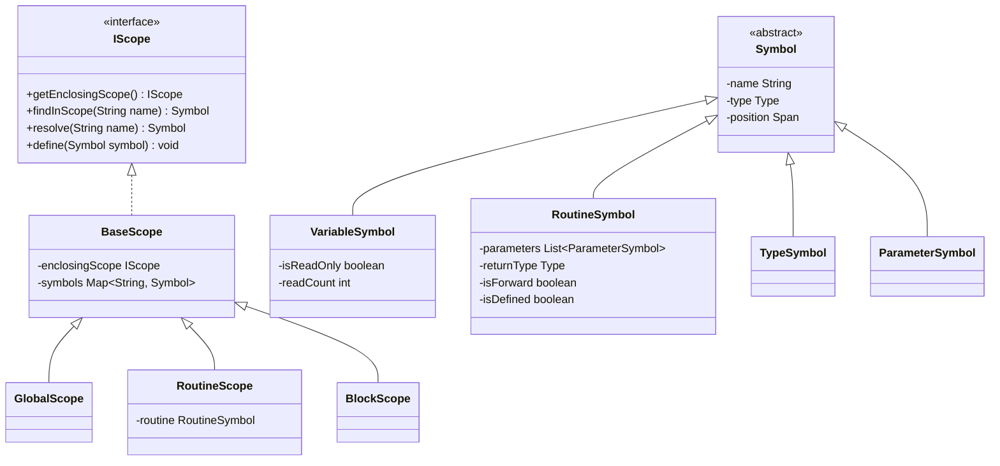
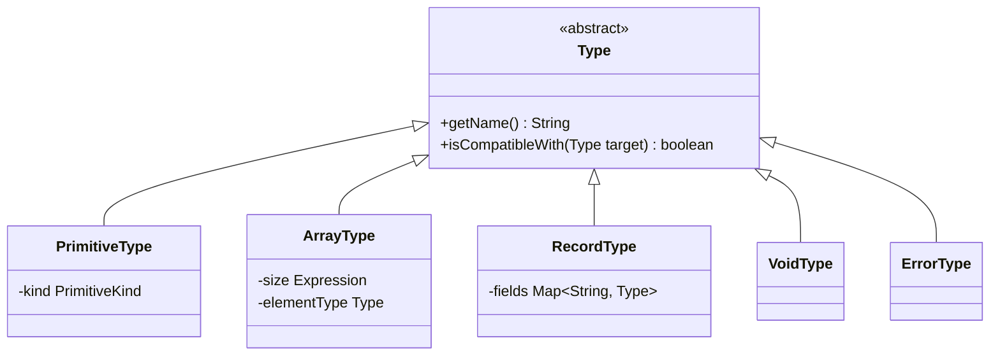
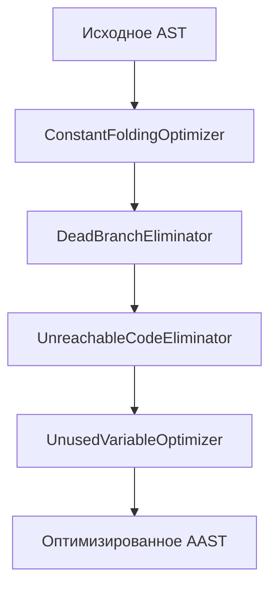

# Комплексный план разработки Semantic Analyzer (Команда Vitebsk)

Настоящий документ содержит полный, строго структурированный перечень всех семантических проверок и оптимизаций с подробным описанием каждого пункта, глубокую архитектурную проработку, структуру пакетов и классов, пошаговые алгоритмы реализации и сбалансированное распределение задач на троих участников команды.

---

## 1. Проверки семантики (Checks)

### А. 4 базовые проверки от куратора (Curator Checks)
*(Данные проверки НЕ модифицируют AST)*

1. **Curator Check 1: Correct Keyword Usage (Корректность контекста ключевых слов)**
   * **Ответственный**: Человек 1 (Вы).
   * **Модифицирует AST?**: Нет.
   * **Подробное описание**:
     Гарантирует, что ключевые слова используются строго в допустимом контексте грамматики и семантики:
     - Оператор `return` ([`ReturnStatementNode`](file:///c:/Users/valer/Desktop/Imperative-JVM-Compiler/src/main/java/ru/innopolis/ast/statement/ReturnStatementNode.java)) разрешено вызывать **только внутри тела подпрограммы**. Использование `return` на верхнем уровне программы (вне рутин) вызывает фатальную семантическую ошибку.
     - Проверка вложенности: запрет объявления подпрограмм внутри тел других подпрограмм (согласно спецификации Language I рутины могут быть только глобальными).
     - Контекст циклов: управляющие конструкции циклов `for` и `while` должны находиться в синтаксически валидных блоках.

2. **Curator Check 2: Declarations Before Usage (Объявление до первого использования и области видимости)**
   * **Ответственный**: Человек 1 (Вы).
   * **Модифицирует AST?**: Нет.
   * **Подробное описание**:
     Проверяет правила доступности идентификаторов и структуру таблицы символов ([`IScope`](file:///c:/Users/valer/Desktop/Imperative-JVM-Compiler/materials/Analyzer/2026%20CC%20BS3%2004%20Case%20Study%20-%20Compiler%20Design%20Remarks.pdf)):
     - Все сущности (переменные, пользовательские типы, функции) должны быть объявлены текстуально выше своего первого использования (за исключением процедур, имеющих опережающее forward-объявление).
     - При вызове подпрограммы или обращении к переменной анализатор проверяет, что такой символ действительно существует в текущем или одном из объемлющих скоупов.
     - **Запрет дубликатов**: в пределах одной области видимости (одного блока `BodyNode`, списка параметров или глобального скоупа) запрещено повторное объявление символа с тем же именем.
     - **Сокрытие (Shadowing)**: объявление сущности во вложенном блоке с именем, совпадающим с внешней сущностью, корректно скрывает внешнюю сущность до конца текущего блока.

3. **Curator Check 3: Type Checking (Контроль типов в операторах и выражениях)**
   * **Ответственный**: Человек 2.
   * **Модифицирует AST?**: Нет.
   * **Подробное описание**:
     Осуществляет глубокий статический вывод и проверку типов в синтаксическом дереве:
     - **Присваивания (`:=`)**: тип вычисленного выражения в правой части ([`AssignmentNode`](file:///c:/Users/valer/Desktop/Imperative-JVM-Compiler/src/main/java/ru/innopolis/ast/statement/AssignmentNode.java)) обязан строго соответствовать типу целевого адресата в левой части (переменной, элементу массива или полю рекорда).
     - **Возврат из подпрограмм**: тип выражения в `return expr` обязан строго совпадать с объявленным возвращаемым типом подпрограммы.
     - **Вызовы функций**: количество переданных аргументов в [`RoutineCallExpressionNode`](file:///c:/Users/valer/Desktop/Imperative-JVM-Compiler/src/main/java/ru/innopolis/ast/expression/RoutineCallExpressionNode.java) обязано равняться числу параметров в объявлении, а типы фактических аргументов должны попозиционно соответствовать типам формальных параметров.
     - **Операции в выражениях**: бинарные операции (`+`, `-`, `*`, `/`, `%`) требуют совместимых числовых типов; логические (`and`, `or`, `xor`, `not`) требуют `boolean`; операции сравнения (`<`, `<=`, `>`, `>=`) применяются только к числовым операндам.

4. **Curator Check 4: Array Bound Checking (Проверка типов индексов и статических границ массивов)**
   * **Ответственный**: Человек 2.
   * **Модифицирует AST?**: Нет.
   * **Подробное описание**:
     - Индекс при доступе к массиву `arr[i]` ([`ArrayAccessNode`](file:///c:/Users/valer/Desktop/Imperative-JVM-Compiler/src/main/java/ru/innopolis/ast/expression/ArrayAccessNode.java)) обязан строго иметь тип `integer`. Использование выражений типа `real`, `boolean` или `string` в качестве индекса вызывает ошибку.
     - **Статическая проверка границ**: если размер массива зафиксирован при объявлении константой (например, `type Arr is array [5] integer`), а индекс `i` вычисляется на этапе компиляции как константное выражение, анализатор проверяет условие: $0 \le i < length$. При выходе индекса за пределы массива выбрасывается семантическая ошибка `Array index out of bounds at compile time`.

---

### Б. Проверки уникальных нововведений команды Vitebsk (Team Extensions Checks)
*(Основаны на спецификации из отчета Vitebsk_report.pdf и тестах проекта)*

1. **Vitebsk Check 1: Fixing the Return Gap (Семантика типизированных и void-подпрограмм)**
   * **Ответственный**: Человек 2.
   * **Модифицирует AST?**: Нет.
   * **Подробное описание**:
     Реализует спецификацию нововведения 1 из отчета команды:
     - Для процедур без объявленного возвращаемого типа (`routine p(...) is ...` — `void`): разрешен **только** пустой оператор `return;` (для раннего выхода). Попытка вернуть выражение `return expr;` запрещена и генерирует семантическую ошибку.
     - Для функций с типом (`routine f(...) : Type is ...`): оператор `return` обязан обязательно содержать выражение возвращаемого значения `return expr;`. Пустой `return;` без значения запрещён.

2. **Vitebsk Check 2: Explicit Entry Point (`routine main`)**
   * **Ответственный**: Человек 1 (Вы).
   * **Модифицирует AST?**: Нет.
   * **Подробное описание**:
     Реализует нововведение 3 из отчета команды:
     - В программе на глобальном уровне обязательно должна присутствовать процедура `routine main() is ... end`.
     - Анализатор проверяет, что подпрограмма с именем `main` действительно объявлена, является процедурой верхнего уровня и не содержит обязательных входных параметров (так как служит стандартной точкой входа виртуальной машины JVM). Отсутствие `main` останавливает компиляцию с ошибкой `Entry point 'main' is not defined`.

3. **Vitebsk Check 3: Strict Typing — No Implicit Casts (Полный запрет неявных приведений)**
   * **Ответственный**: Человек 2.
   * **Модифицирует AST?**: Нет.
   * **Подробное описание**:
     Реализует нововведение 5 из отчета команды:
     - В отличие от базового языка Language I, в компиляторе Vitebsk отключены любые неявные приведения типов между `boolean`, `integer` и `real` во избежание разрастания байт-кода JVM инструкциями ветвления.
     - Запрещены выражения вида `1 + 2.5` (нельзя смешивать `integer` и `real`), а также присваивания `var x: real := 5` (целочисленный литерал не приводится к вещественному неявно). Все подобные несоответствия классифицируются как семантические ошибки типов.

4. **Vitebsk Check 4: Explicit `as` Operator Validation (Валидация явных преобразований)**
   * **Ответственный**: Человек 2.
   * **Модифицирует AST?**: Нет.
   * **Подробное описание**:
     Реализует правила работы явного оператора приведения типов `expr as Type` ([`CastExpressionNode`](file:///c:/Users/valer/Desktop/Imperative-JVM-Compiler/src/main/java/ru/innopolis/ast/expression/CastExpressionNode.java)):
     - Анализатор проверяет допустимость приведения:
       - Разрешены взаимные приведения числовых типов: `integer as real`, `real as integer`.
       - Разрешены приведения между логическим и целочисленным типом: `boolean as integer` (`true` $\rightarrow$ 1, `false` $\rightarrow$ 0) и `integer as boolean` (1 $\rightarrow$ `true`, 0 $\rightarrow$ `false`, прочие значения — runtime error).
     - Запрещены некорректные и бессмысленные касты: приведение записей к числам (`record as integer`), массивов к `boolean` (`array as boolean`), касты в составные типы и т.д.

5. **Vitebsk Check 5: Native `string` Type Validation (Правила строкового типа)**
   * **Ответственный**: Человек 2.
   * **Модифицирует AST?**: Нет.
   * **Подробное описание**:
     Реализует нововведение 4 из отчета команды:
     - Встроенный тип `string` мапится напрямую на `java.lang.String`.
     - Анализатор проверяет, что переменные типа `string` могут инициализироваться строковыми литералами ([`StringLiteralNode`](file:///c:/Users/valer/Desktop/Imperative-JVM-Compiler/src/main/java/ru/innopolis/ast/expression/StringLiteralNode.java)), присваиваться другим строковым переменным и передаваться в оператор `print`.
     - Запрещены некорректные операции со строками: строки нельзя умножать, делить, вычитать или неявно смешивать с числами в арифметических бинарных операциях.

6. **Vitebsk Check 6: 0-Based Array Indexing Semantics (Нативная 0-индексация)**
   * **Ответственный**: Человек 2.
   * **Модифицирует AST?**: Нет.
   * **Подробное описание**:
     Реализует нововведение 2 из отчета команды:
     - Нижняя граница массива фиксируется равной $0$ (вместо $1$ из старого Pascal/Language I).
     - Все проверки диапазонов и генерация семантических контрактов строятся на диапазоне индексов от $0$ до $size - 1$, что исключает рантайм-смещение `index - 1` на JVM.

7. **Vitebsk Check 7: Read-Only `for` Loop Variable (Защита переменной цикла от мутации)**
   * **Ответственный**: Человек 1 (Вы).
   * **Модифицирует AST?**: Нет.
   * **Подробное описание**:
     - Переменная цикла `for` ([`ForLoopNode`](file:///c:/Users/valer/Desktop/Imperative-JVM-Compiler/src/main/java/ru/innopolis/ast/statement/ForLoopNode.java)) объявляется неявно в локальной области видимости тела цикла.
     - Согласно спецификации языка, переменная цикла является **строго неизменяемой (read-only)**. Анализатор проверяет любое присваивание в теле цикла: если целью левой части [`AssignmentNode`](file:///c:/Users/valer/Desktop/Imperative-JVM-Compiler/src/main/java/ru/innopolis/ast/statement/AssignmentNode.java) является переменная цикла (`i := ...`), выбрасывается семантическая ошибка `Cannot assign to read-only loop variable`.

8. **Vitebsk Check 8: Forward Routine Declarations Matching (Сопоставление опережающих объявлений)**
   * **Ответственный**: Человек 1 (Вы).
   * **Модифицирует AST?**: Нет.
   * **Подробное описание**:
     - Если подпрограмма объявлена без тела (`routine foo(n: integer): integer`), она помечается как `forward`.
     - Анализатор проверяет, что в глобальной области видимости ниже по коду присутствует ровно одно полное объявление подпрограммы с таким же именем.
     - Анализатор сверяет сигнатуры: типы параметров и тип возвращаемого значения у forward-объявления и его реализации обязаны быть полностью идентичными.

9. **Vitebsk Check 9: Dual `for` Range Semantics (Вывод типа итератора)**
   * **Ответственный**: Человек 2.
   * **Модифицирует AST?**: Нет.
   * **Подробное описание**:
     Парсер поддерживает два вида заголовка цикла `for`:
     - Диапазон чисел `for i in 0 .. n - 1 loop`: выражения `start` и `end` обязаны иметь тип `integer`, а переменной `i` присваивается тип `integer`.
     - Итерация по массиву `for v in squares loop` (где `squares` — массив): тип переменной `v` автоматически инферится (выводится) анализатором как **тип элементов** данного массива.

10. **Vitebsk Check 10: Array `.size` Property Validation (Проверка свойства длины массива)**
    * **Ответственный**: Человек 2.
    * **Модифицирует AST?**: Нет.
    * **Подробное описание**:
      - В коде (например, в [`examples/13.txt`](file:///c:/Users/valer/Desktop/Imperative-JVM-Compiler/examples/13.txt)) длина массива запрашивается через точку: `s.grades.size`. На этапе парсинга это создаётся как [`RecordAccessNode`](file:///c:/Users/valer/Desktop/Imperative-JVM-Compiler/src/main/java/ru/innopolis/ast/expression/RecordAccessNode.java) с полем `"size"`.
      - Анализатор при проверке обращения через точку `expr.fieldName` выясняет тип `expr`:
        - Если `expr` является **массивом** (`ArrayType`): анализатор проверяет, что запрашиваемое поле — именно `"size"`. Результирующим типом выражения становится `integer` (длина массива).
        - Попытка запросить любое другое поле у массива (`arr.foo`) вызывает ошибку.
        - Свойство `.size` является **read-only**: попытка присвоить значение длине массива (`arr.size := 10`) вызывает ошибку компиляции.
        - Если `expr` является **записью** (`RecordType`): анализатор проверяет наличие соответствующего поля в объявлении структуры `record`.

---

## 2. Оптимизации AST (Optimizations)
*(Данные оптимизации МОДИФИЦИРУЮТ дерево AST)*

1. **Optimization 1: Constant Expression Simplification / Constant Folding (Сворачивание константных выражений)**
   * **Ответственный**: Человек 3.
   * **Модифицирует AST?**: **Да**.
   * **Подробное описание**:
     Рекурсивно обходит поддеревья выражений и, если оба операнда являются константными литералами, вычисляет результат во время компиляции, заменяя узел поддерева на результирующий литерал:
     - Арифметика: `5 + 3` $\rightarrow$ `8`, `10 * 4` $\rightarrow$ `40`, `7.0 / 2.0` $\rightarrow$ `3.5`.
     - Булева логика: `true and false` $\rightarrow$ `false`, `not false` $\rightarrow$ `true`.
     - Операции сравнения: `3 < 5` $\rightarrow$ `true`, `10 = 20` $\rightarrow$ `false`.
     - Константные касты: `true as integer` $\rightarrow$ `1`, `5 as real` $\rightarrow$ `5.0`.

2. **Optimization 2: Control Flow & Dead Branch Elimination (Упрощение ветвлений и циклов)**
   * **Ответственный**: Человек 3.
   * **Модифицирует AST?**: **Да**.
   * **Подробное описание**:
     Анализирует управляющие конструкции с вычисленными константными условиями:
     - Для `if (condition)`:
       - Если условие равно `true`: весь узел `IfStatementNode` заменяется непосредственно на тело ветки `thenBody`, а ветка `elseBody` полностью отбрасывается.
       - Если условие равно `false`: если есть ветка `elseBody`, узел заменяется на неё; если ветки `else` нет, весь `IfStatementNode` удаляется из родительского блока.
     - Для `while (condition)`:
       - Если условие равно `false`: цикл `while` ни разу не выполнится, поэтому узел `WhileLoopNode` полностью вырезается из AST.

3. **Optimization 3: Removing Unreachable Code (Удаление недостижимого кода после return)**
   * **Ответственный**: Человек 3.
   * **Модифицирует AST?**: **Да**.
   * **Подробное описание**:
     Инспектирует списки операторов внутри узлов [`BodyNode`](file:///c:/Users/valer/Desktop/Imperative-JVM-Compiler/src/main/java/ru/innopolis/ast/statement/BodyNode.java):
     - Если в последовательности операторов встречается безусловный оператор `return`, все последующие инструкции, расположенные после него до конца текущего блока, являются гарантированно недостижимым «мёртвым» кодом.
     - Оптимизатор удаляет эти инструкции из списка операторов `BodyNode`, предотвращая генерацию лишнего байт-кода.

4. **Optimization 4: Removing Unused Variables (Удаление неиспользуемых локальных переменных)**
   * **Ответственный**: Человек 3.
   * **Модифицирует AST?**: **Да**.
   * **Подробное описание**:
     Выполняет анализ использования символов (symbol usage tracking):
     - Подсчитывает количество чтений каждой объявленной локальной переменной в теле функции.
     - Если переменная была объявлена через `var x: Type [is expr]`, но ни разу не встречается в выражениях внутри своей области видимости, её узел [`VariableDeclarationNode`](file:///c:/Users/valer/Desktop/Imperative-JVM-Compiler/src/main/java/ru/innopolis/ast/declaration/VariableDeclarationNode.java) безопасно удаляется из дерева (при условии, что выражение инициализации `expr` не содержит вызовов функций с возможными побочными эффектами).

---

## 3. Архитектура Semantic Analyzer и Детальное распределение задач

В соответствии с лекциями 4, 7 и 8 курс требует перехода от «чистого» дерева синтаксиса к **Annotated AST (AAST)**, организованного как серия проходов (passes) над деревом с использованием паттерна **Visitor**.

### 3.1. Структура пакетов в проекте

Все новые классы анализатора создаются в пакете `ru.innopolis.semantic`:

```
ru.innopolis.semantic/
├── visitor/
│   ├── ASTVisitor.java            // Базовый интерфейс обхода дерева (Человек 1)
│   └── ASTTransformer.java        // Базовый класс модификации/перезаписи AST (Человек 3)
├── scope/
│   ├── IScope.java                // Интерфейс области видимости (Человек 1)
│   ├── BaseScope.java             // Базовая реализация цепочки скоупов (Человек 1)
│   ├── GlobalScope.java           // Глобальная область видимости (Человек 1)
│   ├── RoutineScope.java          // Область параметров и тела подпрограммы (Человек 1)
│   └── BlockScope.java            // Блочная область видимости (if, while, for) (Человек 1)
├── symbol/
│   ├── Symbol.java                // Базовый класс символа программы (Человек 1)
│   ├── VariableSymbol.java        // Символ переменной (Человек 1)
│   ├── RoutineSymbol.java         // Символ подпрограммы (Человек 1)
│   ├── TypeSymbol.java            // Символ объявленного типа (Человек 1)
│   └── ParameterSymbol.java       // Символ параметра подпрограммы (Человек 1)
├── type/
│   ├── Type.java                  // Базовый класс семантического типа (Человек 2)
│   ├── PrimitiveType.java         // INTEGER, REAL, BOOLEAN, STRING (Человек 2)
│   ├── ArrayType.java             // Тип массива (размер, тип элемента) (Человек 2)
│   ├── RecordType.java            // Тип записи (мапа полей name -> Type) (Человек 2)
│   ├── VoidType.java              // Тип отсутствия возвращаемого значения (Человек 2)
│   ├── ErrorType.java             // Спец-тип для подавления наведенных ошибок (Человек 2)
│   └── TypeSystem.java            // Правила совместимости и кастов (Человек 2)
├── check/
│   ├── DeclarationAndScopeChecker.java // Pass 1: Резолвинг символов и структурные чеки (Человек 1)
│   ├── TypeChecker.java                // Pass 2: Тайпчекинг выражений и операторов (Человек 2)
│   └── ArrayBoundsChecker.java         // Pass 3: Проверка статических границ массивов (Человек 2)
├── optimize/
│   ├── ConstantFoldingOptimizer.java   // Оптимизация 1: Сворачивание констант (Человек 3)
│   ├── DeadCodeOptimizer.java          // Оптимизации 2 & 3: Мертвые ветки и код после return (Человек 3)
│   ├── UnusedVariableOptimizer.java    // Оптимизация 4: Удаление неиспользуемых переменных (Человек 3)
│   └── OptimizerPipeline.java          // Конвейер применения оптимизаций (Человек 3)
├── context/
│   ├── SemanticContext.java       // Хранилище ошибок и связей AAST (Человек 1)
│   └── SemanticError.java         // Структура ошибки (сообщение, Span) (Человек 1)
└── SemanticAnalyzer.java          // Главный фасад и точка оркестрации (Совместно)
```

---

### 3.2. Детальное архитектурное задание для Человека 1 (Вы)
> **Роль**: Архитектор ядра компилятора и структуры программы.  
> **Самая ранняя часть (Day 1)**: Вы создаёте фундамент, интерфейсы и контракты, которые немедленно разблокируют Человека 2 и Человека 3.



#### Задачи и реализация:
1. **Инфраструктура Visitor**:
   - Создать интерфейс `ASTVisitor<R, C>`:
     ```java
     public interface ASTVisitor<R, C> {
         R visit(ProgramNode node, C context);
         R visit(RoutineDeclarationNode node, C context);
         R visit(VariableDeclarationNode node, C context);
         R visit(TypeDeclarationNode node, C context);
         R visit(ParameterNode node, C context);
         R visit(BodyNode node, C context);
         R visit(AssignmentNode node, C context);
         R visit(IfStatementNode node, C context);
         R visit(WhileLoopNode node, C context);
         R visit(ForLoopNode node, C context);
         R visit(ReturnStatementNode node, C context);
         R visit(PrintStatementNode node, C context);
         R visit(RoutineCallStatementNode node, C context);
         R visit(BinaryExpressionNode node, C context);
         R visit(UnaryExpressionNode node, C context);
         R visit(CastExpressionNode node, C context);
         R visit(ArrayAccessNode node, C context);
         R visit(RecordAccessNode node, C context);
         R visit(RoutineCallExpressionNode node, C context);
         R visit(VariableReferenceNode node, C context);
         R visit(IntLiteralNode node, C context);
         R visit(RealLiteralNode node, C context);
         R visit(BoolLiteralNode node, C context);
         R visit(StringLiteralNode node, C context);
         R visit(RangeNode node, C context);
         R visit(PrimitiveTypeNode node, C context);
         R visit(ArrayTypeNode node, C context);
         R visit(RecordTypeNode node, C context);
         R visit(NamedTypeNode node, C context);
     }
     ```
   - Добавить абстрактный метод `public abstract <R, C> R accept(ASTVisitor<R, C> visitor, C context);` в [`ASTNode.java`](file:///c:/Users/valer/Desktop/Imperative-JVM-Compiler/src/main/java/ru/innopolis/ast/ASTNode.java) и реализовать его во всех узлах через `return visitor.visit(this, context);`.
2. **Модель областей видимости (Scope Hierarchy)**:
   - Реализовать интерфейс `IScope` и цепочку видимости:
     - `GlobalScope`: содержит глобальные процедуры, типы и переменные.
     - `RoutineScope`: вложен в `GlobalScope`, содержит параметры и локальные сущности подпрограммы. Знает свою рутину (для проверок возвращаемого типа).
     - `BlockScope`: вложен в `RoutineScope` или родительский `BlockScope` (тела `if`, `while`, `for`).
   - Метод `resolve(name)` рекурсивно ищет имя вверх по родительским скоупам (`enclosingScope`), обеспечивая лексическую область видимости.
   - Метод `findInScope(name)` ищет только в текущем скоупе (для мгновенного обнаружения повторных объявлений).
3. **Модуль диагностики и контекста (`SemanticContext`)**:
   - Хранит список ошибок: `List<SemanticError> errors`.
   - Хранит мапы AAST (привязки узлов к символам и скоупам):
     - `Map<ASTNode, IScope> nodeScopes`
     - `Map<VariableReferenceNode, Symbol> resolvedSymbols`
     - `Map<RoutineCallExpressionNode, RoutineSymbol> resolvedRoutines`
4. **Алгоритм первого прохода (`DeclarationAndScopeChecker`)**:
   - *Шаг 1 (Предрегистрация)*: обойти `ProgramNode.declarations`. Зарегистрировать имена всех объявленных типов (`type T is ...`) и заголовки подпрограмм (`routine foo(...)`) в `GlobalScope`. Если найдено повторное объявление — зарегистрировать ошибку.
   - *Шаг 2 (Проверка точки входа — Vitebsk Check 2)*: проверить, что в `GlobalScope` зарегистрирован символ `main`, он является рутиной и у него 0 обязательных параметров.
   - *Шаг 3 (Валидация forward-объявлений — Vitebsk Check 8)*: для процедур без тела зафиксировать флаг `isForward = true`. При нахождении реализации с телом — снять флаг. В конце прохода проверить, что не осталось открытых `forward`-объявлений.
   - *Шаг 4 (Обход тел и блоков)*:
     - При входе в рутину создать `RoutineScope`, добавить параметры.
     - При входе в `for` создать `BlockScope`, добавить переменную цикла как `VariableSymbol(isReadOnly = true)` (для **Vitebsk Check 7**).
     - При входе в `if` / `while` создать `BlockScope`.
     - При встрече `VariableReferenceNode` вызвать `scope.resolve(name)`. Если `null` — выдать ошибку `Undeclared identifier` (**Curator Check 2**).
     - При встрече `AssignmentNode` проверить, что адресат левой части не является `read-only` переменной цикла (**Vitebsk Check 7**).
     - При встрече `ReturnStatementNode` проверить, что текущий скоуп находится внутри `RoutineScope`, а не в `GlobalScope` (**Curator Check 1**).

---

### 3.3. Детальное архитектурное задание для Человека 2
> **Роль**: Инженер системы типов и глубокой семантики.  
> **Старт параллельно**: Человек 2 может сразу разрабатывать модель типов `ru.innopolis.semantic.type.*` и правила типизации, пока Человек 1 пишет скоупы.



#### Задачи и реализация:
1. **Семантическая модель типов (`ru.innopolis.semantic.type.*`)**:
   - Создать классы семантических типов:
     - `PrimitiveType`: `INTEGER`, `REAL`, `BOOLEAN`, `STRING`.
     - `ArrayType`: хранит `Type elementType` и узел размера.
     - `RecordType`: хранит мапу полей `Map<String, Type> fields`.
     - `VoidType`: возвращаемый тип процедур без типа.
     - `ErrorType`: специальный тип-синглтон. Если узел содержит ошибку, ему приписывается `ErrorType`, что предотвращает каскад ложных вторичных ошибок в родительских выражениях (согласно лекции 7, слайд 6).
2. **Модуль правил типов (`TypeSystem.java`)**:
   - `isAssignable(Type target, Type source)`:
     - В силу строгой типизации команды Vitebsk (**Vitebsk Check 3**): возвращает `true` **только при строгом совпадении типов**: `integer` с `integer`, `real` с `real`, `boolean` с `boolean`, `string` со `string`. Неявные касты запрещены!
     - Для записей: строгая эквивалентность по имени объявления.
   - `canCastExplicitly(Type from, Type to)` (**Vitebsk Check 4**):
     - Возвращает `true` только для пар:
       `int -> real`, `real -> int`, `bool -> int`, `int -> bool`.
       Для всех остальных типов возвращает `false`.
   - `getBinaryResultType(TokenType op, Type left, Type right)`:
     - Арифметика (`+`, `-`, `*`, `/`, `%`): операнды строго одинаковые (`int + int -> int`, `real + real -> real`). Для `%` допустим только `integer`.
     - Логика (`and`, `or`, `xor`): операнды строго `boolean`, результат `boolean`.
     - Сравнения (`<`, `<=`, `>`, `>=`): операнды `int` или `real`, результат `boolean`.
     - Равенство (`=`, `/=`): операнды одного типа, результат `boolean`.
3. **Алгоритм тайпчекера (`TypeChecker extends ASTVisitor<Type, IScope>`)**:
   - Рекурсивно вычисляет тип снизу вверх (bottom-up inference):
     - `IntLiteralNode` $\rightarrow$ `PrimitiveType.INTEGER`
     - `RealLiteralNode` $\rightarrow$ `PrimitiveType.REAL`
     - `BoolLiteralNode` $\rightarrow$ `PrimitiveType.BOOLEAN`
     - `StringLiteralNode` $\rightarrow$ `PrimitiveType.STRING` (**Vitebsk Check 5**)
     - `VariableReferenceNode`: достать символ из таблицы символов, вернуть `symbol.getType()`.
     - `CastExpressionNode`: вычислить тип выражения, проверить через `TypeSystem.canCastExplicitly()`. При недопустимости — ошибка (**Vitebsk Check 4**).
     - `RecordAccessNode` (**Vitebsk Check 10**):
       - Вычислить тип левой части.
       - Если левая часть — `ArrayType` и имя поля `"size"` $\rightarrow$ вернуть `PrimitiveType.INTEGER`.
       - Если левая часть — `ArrayType`, но поле не `"size"` $\rightarrow$ ошибка `Arrays do not have member X`.
       - Если левая часть — `RecordType` $\rightarrow$ найти поле в `record.fields`. Если нет — ошибка.
     - `ArrayAccessNode` (**Curator Check 4, Vitebsk Check 6**):
       - Проверить, что целевой объект — `ArrayType`.
       - Вычислить тип индекса: если не `INTEGER` $\rightarrow$ выдать ошибку `Array index must be integer`.
       - Вернуть `arrayType.getElementType()`.
     - `RoutineCallExpressionNode` (**Curator Check 3**):
       - Сверить количество аргументов с объявлением.
       - Сверить типы фактических аргументов с типами формальных параметров через `TypeSystem.isAssignable()`.
       - Вернуть объявленный возвращаемый тип функции.
     - `AssignmentNode` (**Curator Check 3**):
       - Если адресат — свойство `.size` у массива $\rightarrow$ ошибка `Cannot assign to read-only property 'size'` (**Vitebsk Check 10**).
       - Проверить совместимость типа цели и типа значения.
     - `ReturnStatementNode` (**Vitebsk Check 1**):
       - Найти текущую рутину в скоупе.
       - Если рутина `void`, а `return` вернул значение $\rightarrow$ ошибка `Cannot return a value from void procedure`.
       - Если рутина типизированная, а `return` пустой $\rightarrow$ ошибка `Missing return value`.
       - Если типы не совпали $\rightarrow$ ошибка несоответствия возвращаемого типа.
     - `ForLoopNode` (**Vitebsk Check 9**):
       - Если диапазон — массив: вычислить тип массива, достать `elementType` и установить его в качестве типа переменной цикла.
       - Если диапазон — числа: проверить, что `start` и `end` имеют тип `integer`.
4. **Статический чекер границ (`ArrayBoundsChecker`)**:
   - При встрече `ArrayAccessNode(array, index)`:
     - Если массив объявлен со статическим константным размером `array [N]` и выражение `index` вычисляется в целочисленную константу:
     - Проверить: $0 \le index < N$. Если нарушено — выдать ошибку `Array index out of bounds at compile time: index is X, size is N` (**Curator Check 4**).

---

### 3.4. Детальное архитектурное задание для Человека 3
> **Роль**: Инженер оптимизаций и трансформации AST.  
> **Старт параллельно**: Человек 3 сразу разрабатывает движок перезаписи дерева `ASTTransformer` и калькулятор констант над литералами.



#### Задачи и реализация:
1. **Движок трансформации дерева (`ASTTransformer`)**:
   - В отличие от read-only `ASTVisitor`, методы `ASTTransformer` возвращают модифицированный `ASTNode` (или `null` при удалении):
     ```java
     public class ASTTransformer {
         public ASTNode transform(ASTNode node) { ... }
         public Expression transformExpression(Expression expr) { ... }
         public Statement transformStatement(Statement stmt) { ... }
         public BodyNode transformBody(BodyNode body) {
             List<ASTNode> newItems = new ArrayList<>();
             for (ASTNode item : body.getItems()) {
                 ASTNode transformed = transform(item);
                 if (transformed != null) newItems.add(transformed);
             }
             return new BodyNode(body.getPosition(), newItems);
         }
     }
     ```
2. **Алгоритм сворачивания констант (`ConstantFoldingOptimizer`)** (**Optimization 1**):
   - Рекурсивно сворачивает поддеревья выражений в технике post-order traversal:
     - `BinaryExpressionNode(left, op, right)`:
       - Сначала оптимизирует `left` и `right`.
       - Если оба узла стали литералами (`IntLiteralNode` или `RealLiteralNode`):
         - `+`, `-`, `*`, `/`, `%`: вычисляет математический результат и возвращает новый `IntLiteralNode(res)` или `RealLiteralNode(res)`.
         - `<`, `<=`, `>`, `>=`, `=`, `/=`: вычисляет булево значение и возвращает `BoolLiteralNode(boolRes)`.
       - Если оба узла — `BoolLiteralNode`:
         - `and`, `or`, `xor`: вычисляет логическую операцию и возвращает новый `BoolLiteralNode`.
       - Алгебраические тождества с одной переменной (Strength reduction):
         - `x * 0` $\rightarrow$ `0`
         - `x * 1` $\rightarrow$ `x`
         - `x + 0` $\rightarrow$ `x`
     - `UnaryExpressionNode(op, operand)`:
       - Если операнд литерал: `-5` $\rightarrow$ отрицательный литерал, `not true` $\rightarrow$ `BoolLiteralNode(false)`.
     - `CastExpressionNode(expr, targetType)`:
       - Если `expr` — `BoolLiteralNode(true)` и каст в `integer` $\rightarrow$ возвращает `IntLiteralNode(1)`.
       - Если `expr` — `IntLiteralNode(5)` и каст в `real` $\rightarrow$ возвращает `RealLiteralNode(5.0)`.
3. **Алгоритм устранения мертвых веток и циклов (`DeadCodeOptimizer`)** (**Optimization 2 & 3**):
   - **Упрощение `IfStatementNode(cond, thenBody, elseBody)`**:
     - После применения Constant Folding к `cond`:
     - Если `cond` стал `BoolLiteralNode(true)`: возвращает `thenBody` (ветка `else` полностью выбрасывается).
     - Если `cond` стал `BoolLiteralNode(false)`: если `elseBody != null`, возвращает `elseBody`; иначе возвращает `null` (узел удаляется).
   - **Упрощение `WhileLoopNode(cond, body)`**:
     - Если `cond` стал `BoolLiteralNode(false)`: возвращает `null` (цикл вырезается из AST).
   - **Удаление кода после return (Unreachable Code Removal)**:
     - При обходе списка операторов `BodyNode.getItems()`:
     - Проходит по инструкциям последовательно. Как только встречает узел `ReturnStatementNode`:
     - Все последующие операторы в этом блоке игнорируются и не добавляются в оптимизированный список операторов.
4. **Алгоритм удаления неиспользуемых переменных (`UnusedVariableOptimizer`)** (**Optimization 4**):
   - Проход 1: Подсчет использований (`readCount`) для каждого символа переменной в выражениях.
   - Проход 2: При обходе `VariableDeclarationNode`:
     - Если у переменной `readCount == 0`:
     - Проверить инициализатор: если он чистый (литерал, переменная, константное выражение без вызовов функций), узел декларации возвращает `null` (удаляется из AST).

---

### 3.5. Интеграция пайплайна в `Main.java`

Связывание всех компонентов воедино реализуется через фасадный класс `SemanticAnalyzer`:

```java
package ru.innopolis.semantic;

import ru.innopolis.ast.ProgramNode;
import ru.innopolis.semantic.check.*;
import ru.innopolis.semantic.context.SemanticContext;
import ru.innopolis.semantic.optimize.OptimizerPipeline;

public class SemanticAnalyzer {
    public static AnalysisResult analyze(ProgramNode ast) {
        SemanticContext context = new SemanticContext();

        // 1. Проход областей видимости, имен и структурных чеков (Человек 1)
        DeclarationAndScopeChecker scopeChecker = new DeclarationAndScopeChecker(context);
        ast.accept(scopeChecker, null);

        if (context.hasErrors()) {
            return AnalysisResult.failure(context.getErrors());
        }

        // 2. Проход проверки типов и статических границ (Человек 2)
        TypeChecker typeChecker = new TypeChecker(context);
        ast.accept(typeChecker, context.getGlobalScope());

        ArrayBoundsChecker boundsChecker = new ArrayBoundsChecker(context);
        ast.accept(boundsChecker, null);

        if (context.hasErrors()) {
            return AnalysisResult.failure(context.getErrors());
        }

        // 3. Пайплайн оптимизаций дерева AST (Человек 3)
        ProgramNode optimizedAST = OptimizerPipeline.optimize(ast);

        return AnalysisResult.success(optimizedAST);
    }
}
```

А в [`Main.java`](file:///c:/Users/valer/Desktop/Imperative-JVM-Compiler/src/main/java/ru/innopolis/Main.java) после этапа парсинга добавляется вызов семантического анализа и печать дерева до/после оптимизации:
```java
// 2. Syntax Analysis
Parser parser = new Parser(tokens);
ProgramNode program = parser.parseProgram();

System.out.println("--- AST BEFORE OPTIMIZATIONS ---");
System.out.println(ASTPrinter.print(program));

// 3. Semantic Analysis & Optimizations
AnalysisResult result = SemanticAnalyzer.analyze(program);
if (!result.isSuccess()) {
    System.err.println("--- SEMANTIC ERRORS ---");
    for (SemanticError error : result.getErrors()) {
        System.err.println(error);
    }
    return;
}

System.out.println("--- OPTIMIZED AAST ---");
System.out.println(ASTPrinter.print(result.getOptimizedProgram()));
```

---

## 4. Сводная таблица всех пунктов для отчета и демонстрации

| Категория | № | Название | Ответственный | Модифицирует AST? | Подробное описание |
|---|:---:|---|---|:---:|---|
| **Curator Check** | **1** | Correct Keyword Usage | Человек 1 (Вы) | Нет | Запрет оператора `return` на глобальном уровне вне функций; запрет вложенных подпрограмм. |
| **Curator Check** | **2** | Declarations Before Usage & Shadowing | Человек 1 (Вы) | Нет | Запрет использования необъявленных переменных, типов и функций; запрет дубликатов в блоке; поддержка shadowing. |
| **Curator Check** | **3** | Type Checking | Человек 2 | Нет | Строгая проверка типов в операторах присваивания `:=`, совпадение типа в `return expr`, проверка аргументов вызова функций. |
| **Curator Check** | **4** | Array Bound Checking | Человек 2 | Нет | Проверка типа индекса массива (`integer`) и статический контроль диапазона $0 \le i < length$ для константных индексов. |
| **Vitebsk Check** | **1** | Fixing the Return Gap | Человек 2 | Нет | В void-процедурах разрешен только пустой `return;` (возврат значения запрещен); в функциях с типом `return expr;` строго обязателен. |
| **Vitebsk Check** | **2** | Explicit Entry Point (`routine main`) | Человек 1 (Вы) | Нет | Обязательное присутствие процедуры `routine main() is ... end` на глобальном уровне без обязательных параметров. |
| **Vitebsk Check** | **3** | Strict Typing (No Implicit Casts) | Человек 2 | Нет | Полный запрет любых неявных приведений типов (`real := 5` или `5 + 2.5` вызывают ошибку компиляции). |
| **Vitebsk Check** | **4** | Explicit `as` Operator Validation | Человек 2 | Нет | Валидация допустимости явных кастов через оператор `as` (разрешены `int <-> real`, `int <-> bool`; запрещены касты рекордов и массивов). |
| **Vitebsk Check** | **5** | Native `string` Type Rules | Человек 2 | Нет | Поддержка строковых литералов, присваивания строк и вывода в `print`; запрет арифметики со строками. |
| **Vitebsk Check** | **6** | 0-Based Array Indexing Semantics | Человек 2 | Нет | Фиксация нижней границы массивов равной 0 (в соответствии с соглашением JVM). |
| **Vitebsk Check** | **7** | Read-Only `for` Loop Variable | Человек 1 (Вы) | Нет | Защита переменной цикла `for` от мутации: присваивание переменной цикла внутри его тела (`i := ...`) запрещено. |
| **Vitebsk Check** | **8** | Forward Routine Declarations Matching | Человек 1 (Вы) | Нет | Проверка обязательного наличия реализации для forward-объявлений подпрограмм с полным совпадением типов параметров и возврата. |
| **Vitebsk Check** | **9** | Dual `for` Range Semantics | Человек 2 | Нет | В числовом цикле `0..n-1` итератор получает тип `integer`; в цикле по массиву тип итератора выводится как тип элемента массива. |
| **Vitebsk Check** | **10** | Array `.size` Property Validation | Человек 2 | Нет | Обращение через точку к массиву `arr.size` типизируется как `integer` (длина массива); свойство `.size` защищено от записи (read-only). |
| **Optimization** | **1** | Constant Expression Simplification | Человек 3 | **Да** | Сворачивание константных поддеревьев (арифметика, логика, сравнения, константные `as`-касты) в литералы на этапе компиляции. |
| **Optimization** | **2** | Dead Branch & Loop Elimination | Человек 3 | **Да** | Замена `if (true)` на тело `then`, замена `if (false)` на `else` (или удаление), полное вырезание циклов `while (false)`. |
| **Optimization** | **3** | Removing Unreachable Code | Человек 3 | **Да** | Удаление инструкций внутри блока, расположенных после гарантированного оператора `return`. |
| **Optimization** | **4** | Removing Unused Variables | Человек 3 | **Да** | Выявление и удаление объявлений локальных переменных, чьи значения ни разу не считываются в коде функции. |
